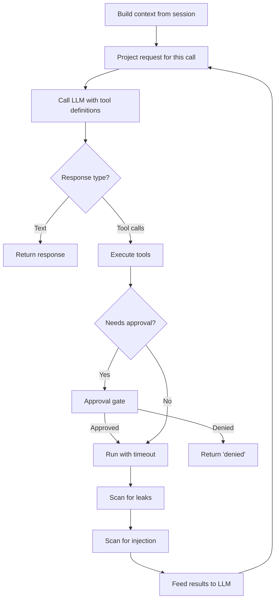

# ReAct Runtime

The ReAct (Reason + Act) loop is the core agent execution model. The runtime takes a conversation context, calls an LLM, executes any requested tool calls, and feeds results back until the LLM produces a text response. The server records a durable turn attempt before entering this loop, awaits structured transcript commits at completed model/tool boundaries, and records terminal provider evidence before response hooks and reply preflight. The final entry and attempt completion still commit together; request recovery and explicit retry are described in [Session Model](sessions.md#durable-turn-recovery).

## Loop Flow



There is no iteration cap. The loop ends when the model returns a response without native tool calls, when a model request fails after its bounded retries, or when the executor stops the task. Repeated identical calls are executed like any others; each gets its own result.

## Security Gates

Each tool call passes through multiple checks. Most are unconditional; the
extension hooks fire only when an extension is registered for that hook
kind and is active on the session.

1. **Rate limiting**: If the tool's resolved policy carries a `rate_limit`, a sliding-window counter checks the call frequency. Excess calls are rejected before execution.

2. **Approval gate**: Checks the tool's `ApprovalRequirement` against the `SecurityContext`. If approval is needed, sends an `ApprovalExchange` over `SecurityContext.approval_callback` and blocks on the decision (`Approve`, `Deny`, `ApproveAll`); `ApproveAll` skips approval for the rest of the turn. What consumes that channel depends on the session: an interactive TUI prompts inline; a bridge-exposed session's daemon proxies the request over the session DB to the bridge (see [Dumb Transport Bridges → Tool approvals](../design/transport_bridges.md#tool-approvals-over-the-session-db)); a session with no approval channel **denies** (fail-closed).

3. **`tool_call` extension hook**: Extensions can mutate the arguments or return `ToolCallDecision::Block { reason }` to short-circuit the call (e.g. `path_normalizer` strips trailing `/` from path args; `security_warnings` is `tool_result`-only).

4. **Timeout + retry**: Execution runs under `tokio::time::timeout(policy.timeout)`. Network errors retry once after 500ms; `Timeout` is never retried (partial work may have succeeded).

5. **Leak detection**: Tool output is scanned against 12 secret regex patterns (`security/leak_detector.rs`). Detected secrets are redacted (`LeakPolicy::Redact`, default) or the call returns an error (`Block`).

6. **`tool_result` extension hook**: After leak scanning, extensions can rewrite the output (e.g. `security_warnings` annotates likely prompt-injection patterns; the scan is currently warning-only and never strips content).

7. **XML wrapping**: Tool results are wrapped in `<tool_output tool="name">` delimiters with angle-bracket escaping before being fed back to the LLM, preventing the result content from being parsed as instructions.

The `before_agent_start` and `agent_end` hooks bracket the whole turn (used today for skill prompt injection at the start and any cleanup the extension wants on completion).

## Runtime recorder

Executor-backed turns pass an awaited `RuntimeRecorder` into the loop. It persists each completed model response before the runtime acts on tool calls, then persists each complete tool result before the next model request. Errors from this interface stop progression rather than becoming best-effort audit warnings.

Scheduled turns currently retain the compatibility `RuntimeEvent` adapter because they do not have a durable turn-attempt record. That adapter projects tool-call and tool-result events to ordinary session entries.

## Cancellation

`execute_cancellable_with_recorder` receives an executor-owned `TurnCancel`, a sticky, idempotent flag with an async wait.
The server stores it with the durable attempt in a session-keyed running-turn map.
Before its processing and queue gates, `process_session` scans for a non-agent `Cancel` event whose request ID and attempt ID both match.
It scans all entries because audit writes can arrive after the control event.
Registration rereads the session to cover an event written between durable start and signal installation.
Wall-clock timestamps do not choose the target.

The runtime races cancellation against model requests (including retry backoff), pending approval, and tool execution, and checks it before each tool call.
It drops the losing work future, but never abandons transcript persistence.
Every remaining call in a recorded native batch gets an awaited `ToolResultOutcome::Cancelled`, including calls not yet started.
The runtime fires `agent_end` and returns `TurnError::Cancelled` with completed-call usage.
The recorder persists cancellation before `agent_end`. The server then commits the same terminal record, visible `Error`, and attempt completion together, and releases the processing slot for the next request.
Complete cancelled exchanges can replay; incomplete persistence leaves an interrupted attempt instead.

On Unix the native shell host places each shell in its own process group and kills that group when its wait is dropped.
Tokio's `kill_on_drop` cleans up the direct child; no shell-job registry or model-callable cancel tool is added.
`execute` and `execute_with_recorder` remain non-cancellable wrappers for existing schedule and test callers.

## Fallback Behavior

- Unbound sessions without tool support fall back to a single-shot LLM call. A reply-capable attached session requires tool support so `no_reply({})` remains available on every turn.
- Otherwise every model request in the turn offers the same tool definitions. The runtime never withholds tools to force a final answer: withholding them lets a model that still wants a tool print its call as plain text.
- A retryable provider error (rate limit, 5xx, timeout, network) is retried with backoff up to the backend's `max_retries`. When retries are exhausted, or the error is not retryable, the turn fails with that error. It is not retried without tools.
- If the model returns an empty response after tool calls, the last tool result becomes the reply on unbound turns. reply-capable attached turns reject empty text without terminal `no_reply`.

## Turn finals, terminal silence, and addressed bridge sends

A normal final from a conversational external-origin turn is a local session
`Message` and an addressed, versioned `BridgeEvent` outbound request committed
with the completed attempt in one transaction.
The local copy references that outbox identity, so later context can show its
pending or sent state instead of presenting it as private text.
A TUI, scheduled, or local-agent final in that session stays local.
Blank model text is an error, not deliberate silence; `no_reply({})` is a sole
terminal model action that completes without a final or external post.
Its definition stays stable across all turns in a conversationally attached
session to preserve the model-call tool prefix.

The optional `matrix__send` tool checks the executing agent's registered Matrix
login and the session's singular attachment, then queues the same generic
outbound event.
A successful explicit send during a Matrix-origin turn counts as its room
reply: its later final remains local and cannot create a second post.
The Matrix bridge sends only addressed outbox events to its bound room, using
per-binding progress and stable transaction IDs; after acknowledgement it
records a generic `BridgeEvent` receipt.
Already-written `MatrixObserved`, `MatrixSend`, and `MatrixSent` entries remain
readable, but are not produced by new code.
Local-only finals, tool audit rows, and agent-to-agent wakes cannot leak into
this addressed Matrix path.
Other transports can use the same core contract; Discord retains its previous
fanout path until migrated.
Source and outbound state come from typed metadata, not mutable body headers.

## Context Assembly

The `ContextBuilder` assembles session entries into `RuntimeMessage` vectors within a token budget. The runtime receives these pre-built messages:

```text
RuntimeMessage::System(role prompt)
RuntimeMessage::User(message 1)
RuntimeMessage::Assistant(message 2)
RuntimeMessage::User(message 3)
...
RuntimeMessage::AssistantToolCalls(calls)
RuntimeMessage::ToolResult(result)
...
```

Before each model call the runtime runs the operator-granted context projection chain over a copy of this vector plus the current attempt's completed exchanges; see [Context projection](extensions.md#context-projection). The projected request is sent (and resent unchanged on transport retries); the local vector and the recorded transcript keep the originals. With no `context_projection` grants the vector is sent as-is.

`AssistantToolCalls` and `ToolResult` messages are maintained in the runtime's local message vector for the active continuation. Completed structured forms are persisted. Later turns can reconstruct complete prior call/result groups from completed attempts inside the conversation budget, but only an exact pending checkpointed `job_wait` can resume an interrupted attempt.

## Concurrency

The server uses a global `Semaphore(10)` to cap executing Agent turns across sessions. Agent tasks acquire a permit before calling the runtime and transfer it to the loop. `ToolContext` carries a runtime-owned observation-yield handle. Synchronous `spawn_worker` uses it only after registering the child and committing its Directive; async submission never yields. After yielding, the tool may only observe and return. The existing `job_wait` path yields for its whole call after the usual approval and extension-call gates.

The loop reacquires a yielded permit outside the tool's timeout and rechecks the parent job's execution branch for an observed earlier branch before processing the result, firing result hooks, or executing another tool or model request. Success, child error, and policy timeout take the same path; reacquisition never registers or submits another child. `job_wait` retains its 30-second default and 240-second maximum, and `spawn_worker` its default 300-second tool policy. Subsequent capacity acquisition may take longer. Executor cancellation and the branch's yield watcher cover observation and acquisition without a separate control path; yielding is cooperative, not a fence.

Before a `job_wait` that ends its batch observes, the loop asks its `RuntimeRecorder` to checkpoint it (`checkpoint_job_wait`). It then gives the tool the same absolute `observation_deadline`. `resume_with_recorder` is the restart entry point: it appends the persisted messages, rebuilds rate-limit, metadata and queued-send state, runs only the pending wait, and enters the normal loop at the next model sequence. It skips `before_agent_start` and starts without **Approve all**. After observation and capacity reacquisition, the recorder durably marks the checkpoint `observation_finished` before any result hook runs. A crash beyond that boundary stays held even if the tool result was not committed. See [Sessions](sessions.md#agent-jobs-and-worker-children).

## Stateless Responses replay

The native Responses adapter keeps the ordered `output` array in the model
response's `provider_extra.openai_responses_output`.
Text responses carry provider data just like tool responses; the runtime
records it before progression, including on a closing boundary that receives
new input.
Final entries retain the terminal array in `ResponseMetadata.extra` so context
assembly restores it at the assistant entry's position rather than duplicating
its flattened text.
In attached sessions, context keeps the host-rendered local/bridge envelope
separately from native output.
The Responses request appends that envelope as user context after the original
items, preserving delivery state without rewriting provider output.
Other APIs use the rendered assistant text as before.
Tool IDs use `call_id`, not the output item's `id`.
The adapter replays every retained item, including encrypted reasoning, before
appending correlated `function_call_output` items.
Pending-wait resume reuses the same provider data from its durable transcript.

Each runtime entry point clones the backend manager into a persisted-session
scope, including resumed turns.
Only the Responses client turns that host-owned scope into `prompt_cache_key`;
cache anchors and extension projection cannot choose it.
The key is a domain-separated digest of the peer-local credential database
root, the existing Living Agent identity (or legacy caller name), backend
connection/credential namespace and session database root.
No raw scope identifier or credential enters the wire key, and no prompt bytes
participate in its derivation.
Legacy standalone calls without a session omit the key.
Usage comes from the response, not from the identity or a predicted cache hit.
