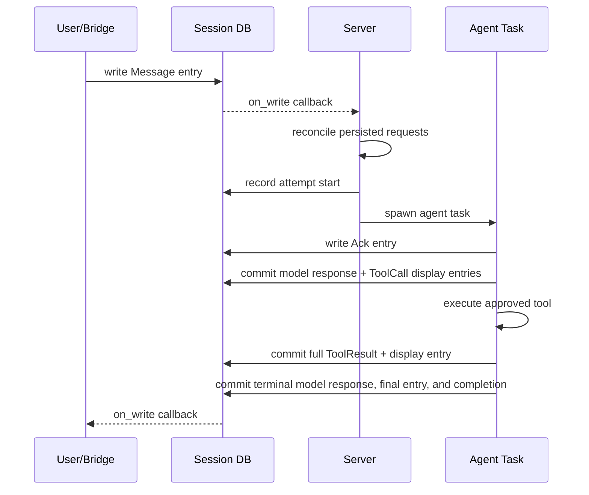
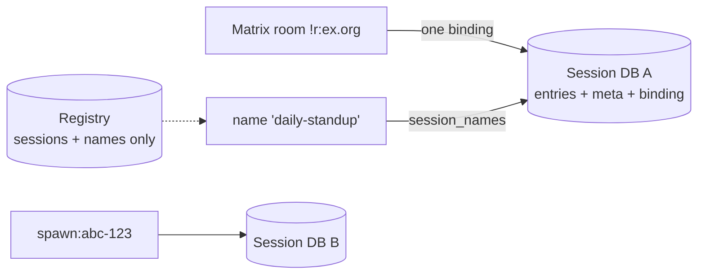

# Session Model

Sessions are the core data model in chaz. Every conversation -- whether from a Matrix room, the TUI, or a spawned Worker invocation -- is represented as a stream of entries in an eidetica database.

## Entry Types

```rust,ignore
enum EntryType {
    Message,    // Chat message (from any participant)
    BridgeEvent, // Versioned external observation, outbox request, or receipt
    Directive,  // Task instruction (from spawn_agent, scheduler, system)
    ToolCall,   // Record of a tool invocation (audit trail)
    ToolResult, // Record of a tool result (audit trail)
    Ack,        // Agent is processing (thinking indicator)
    Error,      // An error occurred
    Summary,    // Compacted summary of older messages (context-builder boundary)
    ApprovalRequest,  // Tool approval requested (control entry, daemon → bridge)
    ApprovalDecision, // Human's approval decision (control entry, bridge → daemon)
    Cancel,           // Participant's stop request for the running turn (control entry)
}
```

Each entry has a sender (participant name), content, timestamp, and type. Its
Eidetica `Table` row key is also the stable identity of a processable turn
request. The key travels with session sync, so two otherwise identical rows
remain distinct requests.

### What Enters the LLM Context

Only `Message`, `Directive`, and `Summary` entries enter the conversation portion of the LLM context as ordinary messages. The context builder maps senders to roles: entries from the current agent become `assistant` messages, all others become `user` messages.

The **system prompt is assembled fresh every turn** from the agent's `system_prompt` + `system_prompt_files` (resolved at agent construction) plus `PromptAugmentation` contributions from the extension hub (skills) and the optional multi-agent room note. There is no per-session persona snapshot — the previous `PersonaSnapshot` entry type was deleted along with `persona.rs` / `role.rs` (see [Skills & Prompts](../design/skills_and_prompts.md)). To change an agent's prompt, edit `system_prompt` / `system_prompt_files` via `/agent set <ref> <field> <value>` (or restart against an edited config file).

`ToolCall`, `ToolResult`, `Ack`, and `Error` entries are excluded from the LLM context. The runtime maintains its active ReAct history in memory. Structured completed model responses and tool results are also written to the attempt's `turn_transcript` store. On a later turn, the context builder joins visible request row IDs to their selected completed attempt at one Eidetica snapshot. It replays only complete native assistant-call/result groups, in request and attempt order, after the triggering request message. An interrupted attempt is not replayed into later turns, and older retry attempts are never included. The executor resumes one kind of interrupted attempt: one whose newest `job_wait_checkpoints` row is the pending end of its own strictly paired transcript (see Agent jobs below). Session-level tool entries remain display projections, never input for reconstruction.

A context-only external observation or a pending addressed send is a known
`BridgeEvent` with provenance and an inert role for turn scheduling.
Receipts are audit-only.
Unknown entry kinds (including future payload-carrying variants) are preserved
and warned about, but excluded from context, wake, and delivery.
Readers still accept existing Matrix-specific event kinds without rewriting
shared history.

`ApprovalRequest` and `ApprovalDecision` are **control entries** for the tool-approval protocol a dumb bridge relays over the session DB — also excluded from the LLM context, from bridge message delivery, and from waking an agent turn. See [Dumb Transport Bridges → Tool approvals over the session DB](../design/transport_bridges.md#tool-approvals-over-the-session-db).

`Cancel` is a control entry too: `/stop` captures the active request ID and attempt ID in a JSON `CancelRequest`, and the owning executor observes it through the session-write path.
Only an exact match from a non-agent sender can stop the running attempt; timestamps are not targeting authority.
An idle stop records nothing, and the event never enters model context or wakes a turn.
A stopped attempt completes with a terminal cancellation transcript record and an agent `Error` carrying completed-call usage.
See [ReAct Runtime → Cancellation](react.md#cancellation) and [TUI → Stopping a Running Turn](../user_guide/tui.md#stopping-a-running-turn).

### Assistant `ResponseMetadata`

Every assistant `Message` entry carries an optional `ResponseMetadata`: the model name, an optional provider and response ID, a `TokenUsage` (prompt/completion/cached/cache_creation/reasoning tokens plus an optional `cost_usd`), and any extra wire-format fields the backend retained. This is populated from the `LLMResponse` returned by the configured `LLMBackend` at the moment the assistant turn is committed to the session DB — there is no separate billing log.

`crates/lib/src/session/usage.rs` walks the session catalog and folds these per-entry metadata records into per-session, per-model, and total rollups. Two surfaces consume those rollups today: the `/costs` slash command (TUI) and the `chaz usage` CLI subcommand. See [Cost Tracking & Usage](../user_guide/usage.md) for the user-facing view.

## Metadata writes refuse unreadable state

`Session::update_meta` and `update_meta_on_db` read all existing metadata
strictly before invoking the mutator or writing. Absent fields use defaults;
storage/read errors, wrong field types, malformed JSON and invalid numeric
fields refuse the entire update. Even an edit to an unrelated field fails.
This prevents a failed read from replacing stored values with defaults.

The rule applies to commands such as `/name` and `/model`, bridge participation
settings, and runtime, agent and job metadata writers, not just the TUI.
Supported legacy ambient metadata formats remain accepted. Malformed metadata
stays write-blocking; these APIs provide no automatic repair or reset policy.
Tolerant routing reads do not authorize a later write from defaulted state.

## Session Lifecycle



### Durable turn recovery

The server treats a non-agent `Message` and a `Directive` as a durable turn
request. It reconciles the request rows rather than acting only on the latest
entry. A queued second request stays pending while the first request runs and
is selected after that attempt finishes.

`turn_attempts` is an append-only table in the session database. A
`TurnAttempt` records the request row key, an attempt ID, a durable generation,
and whether the attempt started or completed. The executor writes the started
record before it can call a model or a tool. It commits a completed record in
the same transaction as the final local response or error entry. Empty model
output is an error, not an intentional message-free completion.

Clients read started attempts and completions from the session DB to show
per-turn activity. A separate `turn_activity` timestamp store is refreshed
by the executor every ten seconds while an agent turn is alive, including
semaphore waits and tool approval. Clients treat a start as visible only for
45 seconds after its last heartbeat (or its original start), and completion
wins even over a late synced heartbeat. Matrix renews its ten-second typing
lease on a three-second timer; the TUI refreshes every five seconds. This
bounded presentation lease is not the session-wide `claim_runtime` lease and
has no effect on reconciliation or retry safety.

Attempt generations establish lifecycle precedence; the start and completion
timestamps are audit data, not the ordering authority. This avoids treating
clock movement across processes or restarts as a newer attempt.

Each completed model response and tool result is stored in `turn_transcript` with the request row key, attempt ID, a monotonic attempt-local sequence, and a timestamp. Model records retain optional text, normalized response metadata, opaque provider continuation fields, and ordered tool calls with their provider IDs, names, and full argument strings. Result records retain the model sequence, call index, call ID, tool name, full output, and a structured outcome.

The recorder is awaited. A tool-call response commits before approval or execution begins, and every tool result commits before another model request. A persistence failure stops the turn. If the tool already caused an external effect, the unmatched attempt remains interrupted and is not replayed automatically. The visible final response and terminal model record commit in the same transaction as completion. Provider retries that have not produced a completed response and streamed tokens do not create records.

The full arguments and results live in the transcript store. `ToolCall` and `ToolResult` session entries are presentation records created by the same successful transaction; result display remains truncated and bridge delivery continues to exclude tool entries. This does not widen approval prompts or bridge exposure of tool secrets.

For each request, reconciliation exposes one of four states:

- **Queued** has no attempt and may run.
- **In flight** has a started attempt owned by the current process.
- **Interrupted** has a durable start without a completion but is not owned by
  the current process. A resumed checkpointed wait becomes in flight again
  under the same attempt ID.
- **Completed** has a completion and never runs again automatically.

On registration, the server captures a session snapshot, installs its
write callback from that snapshot, and reconciles the snapshot for queued
requests, or for an interrupted attempt with a wait checkpoint. The callback
covers commits after the snapshot; the catch-up read covers work already
present before registration. Repeated callbacks are safe:
the persisted request and attempt state decides whether there is work to run.

When a local service client creates a session, the resident executor treats the
peer-local session index as a durable adoption queue. It proves that the shared
user's default key has write authority on the new session, binds that signing
identity, claims the runtime, and registers the ordinary watch/catch-up path.
The executor scans existing rows on startup and rescans after index writes, so
a queued turn survives notification loss and executor restart. This path does
not add transport exposure metadata; bridge-created sessions continue through
the agent registry's `exposed_on` adoption path.

An interrupted attempt is deliberately not replayed. Model and tool work may
already have caused an external effect before the process stopped. The only
automatic continuation resumes an exact checkpointed `job_wait` without
re-executing anything before it (see
[Agent jobs](#agent-jobs-and-worker-children)). The public
library API exposes `Server::interrupted_turns()` to inspect that state and
`Server::retry_interrupted_turn()` to request an explicit retry. The retry is
submitted as a typed row in the session's `session_commands` store. The real
executor accepts it only if its expected interrupted-attempt ID still matches,
then atomically completes the command and writes the new target attempt.
`/interrupted` and `/retry <request_id>` expose this path to TUI and command
clients without granting those clients model or tool authority.

### Durable session commands

`/compact` and `/retry` are typed client-written requests. Their command IDs
are generated before the write and may be reused after an uncertain write;
reusing an ID with a different payload is rejected. They share the session
watch/catch-up callback, per-session processing slot, and `turn_attempts`
lifecycle with ordinary turns. A command start without a completion is
interrupted and never replays automatically. Terminal status and output live
in `session_command_results`, keyed by command ID, so command clients observe
the executor's durable result rather than a local return value.

Retry requests carry both the target turn row ID and the interrupted attempt
ID the client observed. After one retry advances the target generation, a
second command naming the old attempt is rejected as stale. This is durable
deduplication under the documented one-executor assumption, not distributed
fencing or exactly-once external effects.

#### Reader-first wire compatibility

Upgrade **every reader** sharing a session before enabling writers of new wire
variants: executors, TUI/CLI clients, transport peers and history/export consumers.
Entry-kind tolerance alone is insufficient; command, transcript and nested tool
outcome readers must also preserve unknown variants. This is a manual upgrade
contract, not peer discovery or version negotiation.

Unknown variants retain their original JSON through serialization and sync.
Unknown entries are audit-only; unknown commands never start attempts or fabricate
results. Unknown command outcomes are not success or compaction. Unknown native
records or tool outcomes exclude the **entire affected attempt** from replay, so
no orphan call or result reaches the model. Other supported attempts remain readable.
Malformed **known** payloads still fail validation.

Compatibility-only readers do not implement cancellation. Enable stop/cancel
writers only after all readers are upgraded, and use the later stop implementation
for execution. If an older reader fails a history read or shows an empty
conversation, upgrade it rather than deleting or rewriting preserved records.

#### Legacy sessions

New sessions write a turn-schema marker before their first request. When an
executor first registers an older session, it atomically records a baseline of
the rows visible at that point. Those existing transcript rows are consumed;
the server does not infer that they completed, and it does not replay them.
Rows committed concurrently after that baseline are not included and remain
queued. Bridge history backfill is likewise marked consumed rather than made
into new work.

#### Execution boundary and limits

`Server::register_session()` and retry require executor authority. A
client-role server can observe the synced session state, but cannot register
execution, drive agents or models, create execution child sessions, or run
routines and schedules. Build-time validation also rejects runtime options
that would give a client those responsibilities. A future tool fulfiller may
receive separate permission to satisfy selected durable tool requests without
receiving agent/model-driving authority; no such routing, claim, or permission
path exists here, and current tool execution remains local to the executor.

This protocol assumes one executor for a session. The in-process processing
and live-attempt sets serialize that executor's work, but they are not
distributed fencing. The protocol does not provide exactly-once external
effects. Tests cover both a shared Eidetica service with separate client and
executor connections and direct peers syncing a session over HTTP; neither
topology adds multi-executor election or fencing.

## Session Registry

A session is identified solely by the root ID of its own eidetica `Database`. The `SessionRegistry` holds two index stores inside the peer-local `chaz_group` DB — nothing load-bearing about a session lives here:

- **`sessions`**: every known `session_db_id` → origin tag (for debugging/listing)
- **`session_names`**: human-friendly `name` → `session_db_id`

The canonical per-session configuration (name, agent, model, role, backend) lives in each session's own DB under a `meta` DocStore as a `SessionMeta`. Because it lives in the session, it syncs with the session via eidetica — sharing a session also shares its config.



### Matrix channels

An external attachment is an explicit `(transport, login_id, channel)` record in the session DB, with a reply capability for conversational adapters.
There is at most one publishable external attachment per session; TUI/CLI remain local clients, not extra attachments.
An addressed Matrix message in a new room creates and attaches a session, while unaddressed messages in an already-attached room become context-only `BridgeEvent` observations.
`!chaz attach <session>` rejects another external binding until explicit detach or migration, and `!chaz channels` lists bindings.
The bridge delivers only generic addressed outbound events for its own login and room, then records a generic receipt.
A Matrix-origin final enters that outbox atomically with its local copy; TUI, schedule, and local-agent finals never enter it.
Startup reconciliation and per-binding progress retry queued sends even when the agent is offline.
See [Matrix Bot](../user_guide/matrix.md#attached-rooms-and-reply-routing).

### Named Sessions

Sessions can be given human-friendly names via `set_session_name()` (TUI: `/name <alias>`). Names are persisted in the registry's `session_names` index and mirrored into the session's `meta` doc. `resolve_session()` tries name → DB ID, so names work everywhere a session identifier is accepted (`/join`, schedules, etc.).

## Context Building

`ContextBuilder` (in `context.rs`) renders a coherent host-owned view. The required
`baseline_context` extension selects history and layout through public scoped APIs
within the existing token budget:

1. Account for system prompt and tool definition tokens first
2. Resolve a successful `/compact` snapshot boundary, or the most recent legacy `Summary`
3. Filter for `Message`, `Directive`, and `Summary` entries
4. Fill from newest messages backward until the token budget is exhausted
5. Spend only remaining budget on complete native call/result groups; preview oversized results or skip the group
6. Map senders to roles: current agent name = `assistant`, everything else = `user`

Historical tool results use the same escaped `<tool_output>` boundary as live results. Outputs are leak-scanned before persistence and capped at 100 KB, including native/custom tools; legacy larger records are capped on replay. Authorized session peers sync the bounded transcript. A compact snapshot excludes covered requests and their tool exchanges; legacy summaries also bound both. Missing or malformed records supply no tool history.

Token estimation uses tiktoken (`cl100k_base` BPE tokenizer) for accurate counting. The budget is `max_context_tokens - reserved_output_tokens`, configurable globally and per-agent.

### Compaction

The `compact` tool retains the legacy behavior of writing a `Summary` entry.
`/compact` captures an Eidetica `Snapshot`, then the executor reads that native
historical view and writes a typed compact result. Context assembly uses the
snapshot's parent history as the coverage boundary: the persisted summary is
followed by every current context entry outside that snapshot. A message
committed while summarization is running therefore remains visible, even when
its timestamp sorts before command completion. Successive compactions read the
prior virtual boundary through the same snapshot-backed context path. No
covered-entry list or parallel Chaz ancestry graph is stored.

## Eidetica Sync

Because each session is a standalone eidetica database, sessions can be synced between chaz instances. The `/share` command generates a `DatabaseTicket` URL, and `/sync` pulls a remote session. Eidetica handles the Merkle-CRDT synchronization protocol.

Synced sessions receive remote writes via eidetica's `on_write` callbacks with `WriteSource::Remote`, triggering the same bridge notification path as local writes.

## Home Peer (Per-Session, with Agent-Level Fresh-Timer Default)

When an agent is co-owned (multiple peers hold an authorized key on the agent DB) and attached to the same session, both peers would otherwise wake on the same human message and both run the ReAct loop — a forked turn. The home-peer gate elects exactly one peer per (session, agent) to execute.

State lives in two places:

- **Per-session**: `AgentRef.home_pubkey` inside `SessionMeta.agents`. Set automatically on attach to the attaching peer's pubkey on the agent DB. Rewritten by `/agent rehost`. `None` (legacy) means "any keyholder runs" — back-compat for sessions that predate this feature.
- **Agent-level**: `meta.home_pubkey` on the agent DB itself. Used only by `fire_agent_schedule`'s `Fresh` target, where no session exists yet to carry the per-session field. Set automatically by `create_agent_db` to the creator's pubkey. Rewritten by `/agent rehost --agent`.

The gate fires at three sites:

- `process_session` (interactive turns) — uses the per-session home.
- `fire_agent_schedule(Fresh)` — uses the agent-level home (no session yet).
- `fire_agent_schedule(Pinned)` — uses the per-session home of the pinned session.

When a non-home peer's gate fires, an in-memory skip counter increments. At a threshold of 3 consecutive skips per (session, agent), a WARN logs the exact `/agent rehost` command to take over from a surviving peer. The counter resets on a successful run or on rehost.

Failover is **explicit and operator-driven** in v1. If the home peer's chaz process is down, its (session, agent) pairs go silent. Recover with `/agent home-status` (query) and `/agent rehost` (take over from another peer holding a key). Automatic / liveness-based failover is deferred: eidetica's daemon/client split makes presence inference unreliable, and any opportunistic auto-claim re-introduces the very fork this system exists to prevent.

`/agent revoke-peer` emits a soft warning when the revoked key was the home for any sessions or agent-level state, listing what needs rehosting; it does not block the revoke.

Agent jobs are admitted only for Agents hosted by the local executor. Their child sessions pin the target Agent/home identity; the home gate is not a cross-peer delegation mechanism or an exactly-once execution fence.

## Agent jobs and Worker children

`spawn_agent` submits one durable Agent job, not a workflow graph. The submitter prepares one child session DB with parent delegation, a request record and exactly one Directive before publishing its ID to the existing watched catalog. An unpublished child is inert; a published child is `Pending` until an executor checks its parent, hosted target/home and broad scope, then pins inherited per-tool grants, capability and depth ceilings and records acceptance in the **same** DB. Invalid requests become `Rejected` without running. Submission returns the DB ID after publication, not after acceptance or execution. A lost creation response requires inspecting the indexed jobs before another submission; there is no stable parent request key or automatic submission retry. Same-login local clients can create and observe jobs but cannot admit or execute them. Narrow, workspace and private scopes are rejected in v1.

After `Pending` admission or `Rejected` refusal, job status comes from the accepted Directive's attempt and typed terminal receipt: queued, running, started-unknown (a client cannot prove liveness), interrupted (executor sees a start without completion), succeeded, or failed. At most ten turns hold runtime permits for actual execution; accepted jobs wait **queued before starting an attempt** when capacity is full. An in-Agent `job_wait` yields its permit during observation without releasing its processing reservation, attempt, or execution branch. It reacquires before result hooks, further tools, or model requests, including after tool errors and timeouts. The execution branch's yield watcher covers observation and reacquisition; a fresh ordering check after reacquisition prevents continuation once an earlier branch has been observed. Cancellation drops the turn's permit or pending acquisition. After restart, queued jobs are adopted; a started attempt without completion is not replayed automatically. Inspect it and explicitly retry if appropriate, since effects may already have occurred. `job_wait` only observes and a timeout does not cancel.

**Checkpointed waits.** Before a `job_wait` that ends its model response observes, the runtime commits a versioned `JobWaitCheckpoint` row to the parent session DB's `job_wait_checkpoints` store. The row key is attempt, model sequence and call index, so rewriting the same call cannot add a row. The row records the request and attempt, Agent name, call ID and post-hook arguments, child handle, the session snapshot the turn's context came from, and an absolute deadline. The runtime gives the tool that same deadline (`ToolContext::observation_deadline`). A turn with **Approve all** or extension-injected pre-turn messages writes no row, because the loader could not restore that state.

On a wake, including the one adoption sends after a restart, the executor examines interrupted requests in session order. It resumes one only when `plan_job_wait_resume` accepts it: the attempt's records are contiguous from sequence 0 for one attempt and request; every earlier model response is non-terminal and followed by exactly its paired results; and the last response's final call is the checkpointed `job_wait` with no result. The resumed attempt keeps its attempt ID and its context snapshot, and appends after its last sequence. Earlier results are reused with the exact content the live loop appended. Only the wait runs, under the remaining deadline and policy budget, and the loop then continues.

The checkpoint is durably marked `observation_finished` after observation and capacity reacquisition, before result hooks run. A persistence failure at that boundary stops the turn without running those hooks. A crash beyond it stays held, even if the result is missing, because a hook may already have had effects. The receipt is retained with its original identity and deadline.

Before marking the attempt live, the executor holds the session's processing reservation, revalidates the attempt and checkpoint, records a job parent's participation, and checks Agent resolution, home peer, attachment policy and `job_wait` scope. A process remembers every checkpoint it resumed or refused, so duplicate wakes and stopped resumes cannot advance it twice. Anything else, including a missing, advanced, mismatched or unknown-version checkpoint, stays `Interrupted` for `/retry`.

**Execution participation and branches.** An Agent job has no expiring owner claim. Once routing, role, home and inherited-authority checks pass, the executor writes one idempotent `execution_participants_v1` row for its stable identity (hosted target Agent DB plus home-peer key). Participation is never renewed, never expires and grants nothing; it does not imply liveness or exclusivity, and several process incarnations of one executor share it. No timer writes job ownership.

Every run of a job attempt, including a resumed checkpoint segment, records an immutable `execution_starts_v1` row before model/tool work: branch ID, executor, process incarnation, attempt, optional explicit-retry identity, and, for a continuation, the exact checkpoint and predecessor branch. Branch order is Eidetica's canonical store-entry order (subtree height, then entry ID), the same comparator it uses for CRDT replay, so every reader with the same committed starts derives the same order regardless of arrival, row-iteration or completion order. Two branches compete when they serve the same request with the same retry identity and neither continues the other. A continuation competes at its lineage root's position, so a competitor committed between a branch and its continuation still yields to that lineage; parallel resumes of one predecessor fall back to their own positions. A branch that observes an earlier competitor, or a continuation of itself, records an `execution_yields_v1` row, stops further model/tool steps and releases its capacity; it is never revived. Observation happens on session writes, at each model boundary, after a yielded wait reacquires capacity and immediately before settlement. It is cooperative, not a fence: an in-flight tool's effects remain and no exactly-once effect is promised.

Settlement needs no fresh ownership. A branch that has observed no earlier competitor commits its `execution_outcomes_v1` row (`delivered: true`), the job receipt naming its branch, the completed attempt and its terminal transcript in one transaction. The receipt slot is never replaced: a branch that finds another branch's receipt, or has yielded, keeps its computed result as an undelivered outcome and leaves the attempt to the earlier branch. Each branch's transcript is also kept separately in `execution_transcript_v1`, so two branches of one attempt never share a sequence. An undelivered computed result and its buffered terminal transcript are committed together as branch evidence, without completing the attempt or replacing its receipt. The continuing branch receives at most four deduplicated notices per boundary (`execution_notices_v1`/`execution_notice_seen_v1`) naming the parallel executor and a `job_status` handle that views or searches that branch's transcript in bounded pages; the transcript is never injected. A closing boundary consumes none, so no model call is made just to announce one. If an earlier branch is learned only after delivery, the delivered branch records its yield and an ordering-correction notice; the receipt and transcript are unchanged and the parent's next `job_status` or `job_wait` reports the correction. Nothing is replayed or rolled back.

A session joins this protocol through an `execution_protocol` activation row. A new job session activates itself before its first attempt. A historical session, with attempts or a legacy `job_owner` row, is held until an operator stops every old writer and calls the explicit coordinated-upgrade activation (`session::execution::activate_after_coordinated_upgrade`; there is no slash command for it yet); activation records the legacy row exactly, and any later legacy write makes new writers refuse the session. An old binary ignores the marker, so the check detects mixed writers but cannot stop them. Historical receipts and transcripts stay readable.

Session affinity is a deferred interface only: a placement requirement a session or extension could someday state, not a permission grant and not a liveness signal. Nothing reads, enforces or configures it in this release. The pinned child authority cannot exceed the parent's admitted ceiling; `spawn_worker` is excluded from Agent-job delegation.

`spawn_worker` is a separate Worker-template invocation, synchronous by default, with no durable Agent-job handle or Agent identity. Its child session must not be treated as an accepted Agent job.

### Local job monitoring and next-call input

Each Agent references one stable Executor DB per local executor key. Its
`jobs` table projects only jobs this executor participates in, with immutable job,
parent and Agent/executor identities. The Session DB owns attempts and terminal
receipts. Participation/start projection failures stop before model/tool work; a failed
mid-run projection stops further effects. Restart reconciliation repairs the
projection without replaying interrupted attempts. Local readers use the
Agent's authorized delegated identity. Unreadable references remain explicit
unavailable sources; this path adds no remote fetch or Chaz sync engine.

Entered `job_wait` calls write attempt-associated, bounded wait activity to
`job_waits`. An unfinished record can survive interruption and is not liveness.
The TUI derives ancestry from job request/acceptance records, with referenced
pending children and ordinary parent conversations shown only as context.
Observe-only tabs install DB callbacks, not server runtime registration.
Local-v1 monitoring checks native `current_permission()` / `can_write()` on
Agent sources and session reads. The existing single-hop Executor reference
uses the Agent's native permission clamped by the Executor DB's native
`PermissionBounds`; the service still validates its delegated identity on every
operation. Existing Write or Admin authority is required. Read-only and unauthorized callers receive an
explicit insufficient-permission/unavailable outcome. Refresh rechecks authority,
including reductions after opening. These credentials are write-capable even
though observation publishes no job changes and never acquires execution.
This temporary boundary avoids the current service's Read-only native-record
cache materialization failure; it does not repair that dependency. True Read
support remains deferred. No automatic grants, key upgrades or alternate
privileged identity are introduced. A service session handle whose native
permission query cannot resolve delegation stays explicitly unavailable rather
than guessing authority or falling back to another key.

### Shared active-turn steering

Chat and Job observers publish the same `JobInputRequest` through Session's
steering API. Existing `job_inputs`, `job_input_receipts` and `job_input_closed`
wire names remain unchanged. The native signed input-store DAG orders
publications, including encrypted stores; random Table keys and publisher
clocks do not rank inputs. One request is published per commit. The latest
attempt generation plus recent activity is required; an old heartbeat cannot
authorize input for a superseded attempt. Jobs additionally require their
accepted Directive's attempt and retain their terminal view-only restriction.
Idle Chat alone creates an ordinary Message. A delayed busy publication keeps
its observed attempt target and is never silently converted to idle work.

At a whole-response/full-native-batch boundary the executor selects all pending
input and records acceptance, with its intended model sequence in
`job_input_calls`. Selection does not imply dispatch. After required projection
and request-budget validation, `RuntimeRecorder::input_dispatch` verifies that
the actual message vector retains the selected input in order. It atomically
writes a structured `TurnTranscriptMessage::Steering`, dispatch receipts and
non-runnable `TurnContext` display rows. The latter also preserve nonterminal
assistant text, but are not Message/Directive requests or bridge outbox events.
A response observation advances the receipt independently of local
incorporation; a failed dispatch remains uncertain. The TUI reads incorporation
and display at one snapshot, so refresh cannot hide pending text before its
promoted rows exist.

Completed-attempt context reconstruction includes steering and nonterminal
assistant text in their original positions alongside strictly paired native
exchanges, with exact call provenance and token costs. The same validation
restores a checkpointed wait; only its pending observation executes. Unknown
records, repeated call boundaries, duplicate input identities or unpaired
native history refuse the entire reconstruction. Cancellation before a
steered call returns also refuses replay of that group: local incorporation
alone cannot carry unconfirmed input into a later turn. `TurnContext` rows alone never
supply context, including on retry, so unconfirmed input cannot leak from a
failed attempt's display into a later turn. Normal history selection and
compaction budgets still apply.

An empty closing boundary writes `job_input_closed`. A publication racing that
marker remains recoverable but is not applied; accepted input demands
same-attempt continuation before the terminal receipt. Finished Jobs cannot
replace a parent-delivered result. These records use the existing signed
session authority and cooperative execution branches, not distributed fencing.
There is no new executor, tool authority, follow-up queue or effects replay.

Upgrade readers before enabling writers of `Steering` transcript records and
`TurnContext` entries, following the [reader-first contract](#reader-first-wire-compatibility).
Older tolerant readers preserve those variants but do not display promoted
text or replay the affected attempt's structured history. They hold an affected
checkpoint rather than partially resuming it. Older executors do not implement
Chat steering, so mixed writers can leave published input unapplied. There is
no automatic negotiation or migration of existing history.
