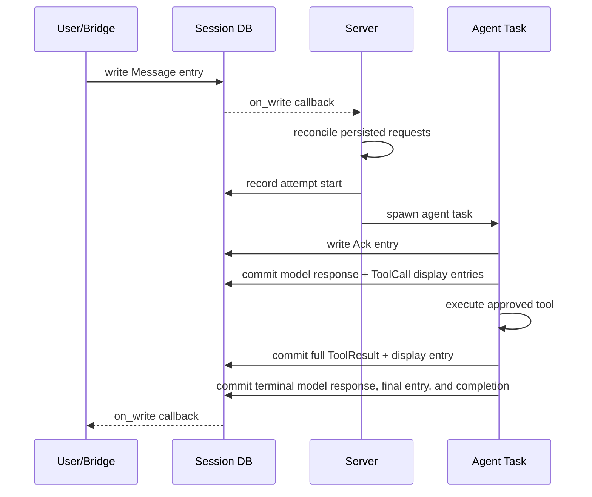
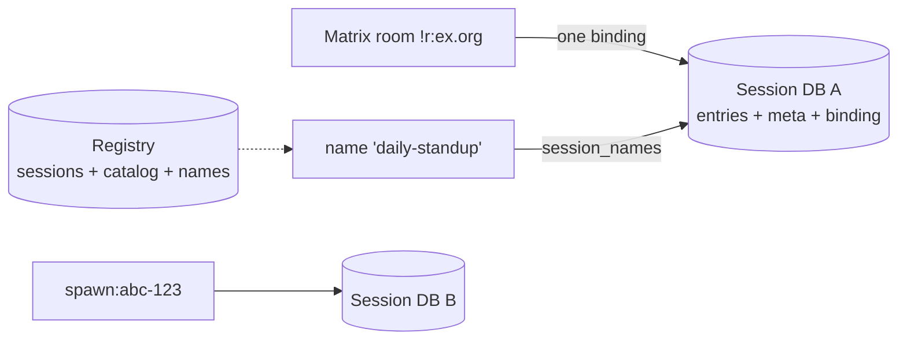

# Session Model

Sessions are the core data model in chaz. Every conversation -- whether from a Matrix room, the TUI, or a spawned Worker invocation -- is represented as a stream of entries in an eidetica database.

## Entry Types

```rust,ignore
enum EntryType {
    Message,    // Chat message (from any participant)
    BridgeEvent, // Versioned external observation, outbox request, or receipt
    Directive,  // Task instruction (e.g. the submitted Agent job or Worker task)
    ToolCall,   // Record of a tool invocation (audit trail)
    ToolResult, // Record of a tool result (audit trail)
    Ack,        // Agent is processing (thinking indicator)
    Error,      // An error occurred
    Summary,    // Compacted summary of older messages (context-builder boundary)
    ApprovalRequest,  // Tool approval requested (control entry, daemon → bridge)
    ApprovalDecision, // Human's approval decision (control entry, bridge → daemon)
    Cancel,           // Participant's stop request for the running turn (control entry)
}
```

Each entry has a sender (participant name), content, timestamp, and type. Its
Eidetica `Table` row key is also the stable identity of a processable turn
request. The key travels with session sync, so two otherwise identical rows
remain distinct requests.

### What Enters the LLM Context

Only `Message`, `Directive`, and `Summary` entries enter the conversation portion of the LLM context as ordinary messages. The context builder maps senders to roles: entries from the current agent become `assistant` messages, all others become `user` messages.

The **system prompt is assembled fresh every turn** from accepted Agent DB configuration and its synchronized individual source texts, plus `PromptAugmentation` contributions and any multi-agent room note. Settings and sources are read from one atomic config record; migrated agents do not depend on another peer's unsynchronized prompt store or pending local files. Worker invocations carry the selected template's resolved prompt into their child runtime without changing identity, ownership or capability attenuation. There is no per-session persona snapshot. Operator commands project outward, explicit `/agent reload` imports the managed folder, and startup never imports a draft; see [Agent folders](../user_guide/agents.md#two-representations-one-accepted-configuration).

The Agent DB `config` store and the agent and bank `meta` stores retain Eidetica's `docstore:v0` type. At `value`, Chaz reads legacy JSON Text or an atomic Doc with `version: Int(1)` and a nested `fields` Doc. The store and driver (`AgentDb`, `MemoryBankDb`, or `SkillBankDb`) determine the field schema. Display metadata is independent of the top-level routing and home-key markers. Nested Docs and Lists are complete values inside the atomic boundary; competing writes resolve to one record, never a mix of settings, grants and sources. Fields use native nulls, booleans, text and signed 64-bit integers. The pinned API interprets dotted keys as paths, so dotted keys and keys beginning with `~` use the same `~` plus UTF-8 hex escape as extension settings. An unsigned integer above `i64::MAX` uses the existing `~number` decimal Text tag; Chaz does not truncate it. Legacy snapshot IDs retain their Eidetica string form.

A bridge's bootstrap-request metadata carries its `LoginRef` claim at `chaz_login_ref` (`LoginRef::to_metadata`/`from_metadata` in `agent_db.rs`). The reader accepts legacy JSON Text or the native v1 claim: an atomic Doc with exactly `version: Int(1)`, `kind`, `identifier` and `bridge_db_id` as Text, `peer_pubkey` and `agent_pubkey` as Text or Null (absent stays distinct from empty), and `sync_addresses` as an ordered List of atomic `{transport, address}` Text pairs, duplicates kept. Anything else, including another version, decodes as no claim. The outer metadata Doc stays at Eidetica's own Doc format version; the claim version is a Chaz field. Bridges still write legacy text until every approver reads both; see [Login claim formats](../user_guide/bridges.md#login-claim-formats-and-upgrade-order). The claim is requester-supplied and unsigned beyond the request's proof of key possession, never an input to the grant, the request ID or Eidetica's rejection and non-disclosure checks.

The `Doc` codec serializes typed values into subtree bytes; the enclosing entry uses DAG-CBOR for its content ID and signing representation. New writes append entries without changing the registered store type, database root, or historical entries and their signatures. The codec is not a Chaz JSON-text record or a promise of equal entry IDs for equal logical configurations. See [upgrade and recovery](../user_guide/agents.md#upgrading-agent-and-bank-records) for reader compatibility.

`ToolCall`, `ToolResult`, `Ack`, and `Error` entries are excluded from the LLM context. The runtime maintains its active ReAct history in memory. Structured completed model responses and tool results are also written to the attempt's `turn_transcript` store. `Session::history_at` opens an exact accepted Eidetica snapshot. Its context view joins each visible request row to its selected completed attempt and keeps the native transcript keys and call indices. The context builder replays complete exchanges, including non-terminal assistant text and paired call/results, after the triggering request message.
Responses final-entry metadata also restores complete terminal output and its host-owned replay origin at the assistant entry's position; see [stateless Responses replay](react.md#stateless-responses-replay). An interrupted attempt is not replayed into later turns, and older retry attempts are never included. The executor resumes one kind of interrupted attempt: one whose newest `job_wait_checkpoints` row is the pending end of its own strictly paired transcript (see Agent jobs below). Session-level tool entries remain display projections, never input for reconstruction.

A context-only external observation or a pending addressed send is a known
`BridgeEvent` with provenance and an inert role for turn scheduling.
Receipts are audit-only.
Unknown entry kinds (including future payload-carrying variants) are preserved
and warned about, but excluded from context, wake, and delivery.
Readers still accept existing Matrix-specific event kinds without rewriting
shared history.

`ApprovalRequest` and `ApprovalDecision` are **control entries** for the tool-approval protocol a dumb bridge relays over the session DB — also excluded from the LLM context, from bridge message delivery, and from waking an agent turn. See [Dumb Transport Bridges → Tool approvals over the session DB](../design/transport_bridges.md#tool-approvals-over-the-session-db).

`Cancel` is a control entry too: `/stop` captures the active request ID and attempt ID in a JSON `CancelRequest`, and the owning executor observes it through the session-write path.
Only an exact match from a non-agent sender can stop the running attempt; timestamps are not targeting authority.
An idle stop records nothing, and the event never enters model context or wakes a turn.
A stopped attempt completes with a terminal cancellation transcript record and an agent `Error` carrying completed-call usage.
See [ReAct Runtime → Cancellation](react.md#cancellation) and [TUI → Stopping a Running Turn](../user_guide/tui.md#stopping-a-running-turn).

### ConversationStore v1: reads and fenced writer fixtures

`Session::history_at` binds the read to the caller's Database handle and one
accepted main frontier. Only that handle selects a format. With no v1 traces
it runs the legacy interpreter, including its positional summary cutoff,
completed-attempt join, and native dates. Opening history does not change the
session's stores or turn baseline.

For a supported descriptor, the ConversationStore interpreter checks signed
atom deltas and the typed Store materialization. A descriptor pins a legacy
prefix by database and frontier; the interpreter takes row IDs and native
exchange members from the existing grouped legacy read. A v1 replacement
consumes only its named representations, not everything preceding its
summary. Both formats feed the same context selection API. Native call/result
groups are indivisible, and v1 records without a recorded date do not invent one.

A missing descriptor on v1 data, an unsupported record, malformed ancestry,
or an ambiguous replacement refuses the affected effective read rather than
switching to legacy. Authorized `HistoryRead::inspect_conversation` retains
atom text and invalid delta bytes even when interpretation refuses.
`recorded_call` reads the immutable preparation at its original observed
selection, not the latest context and not a replay or dispatch receipt.

Only tests can admit a v1 writer. They start from a fresh synthetic session and
use the regular runtime and its attempt-bound recorder with a loopback
backend, an in-process tool, and one before-agent hook. The Store validates and
stages data; the host commits it before dispatch or publication. It commits
the native response, outcome, and compact accounting together. A final reply
with unchanged text references the response instead of storing another body.
`/print` renders the committed reply, not an observed model response that has
yet to settle. Reads do not resume attempts or replay effects.

If a correction arrives while a request is in flight in the single-turn
fixture, the reply still descends from its dispatch intent, not the latest tips.
The writer checks current permission, its attempt, and cancellation separately
from that history. A joined read includes both appends once. It does not imply
that the earlier request saw the correction, or that stable display order
identifies a reply target. The [merged history comparison](../design/merged_context.md)
shows why the next model request keeps the flat rendering, and when a cue
about prior visibility would add information at the cost of history.

`/print` keeps the joined transcript in stable order. For a fenced reply, the
completion links its final response to the request's accepted input. If that
input is still visible and another user message intervenes, `/print` quotes a
short preview of the accepted input. The cue names the trigger, not every
message the model saw. It does not change the stored conversation or model
context.

Dated row APIs used by queues and transport delivery do not present v1
projections as legacy rows. The single-turn fixture's descriptor requires
`fenced-turn-v1` and `fenced-input-appends-v1`; readers that do not understand
these capabilities must refuse the effective read. The second capability admits
plain user appends, not new attempts. No production path creates this
descriptor, enables v1 writes, or converts existing histories. The fixture
does not provide a distributed authority barrier or exercise durable projection
hooks, bridge publication, or waits.
Before enabling production writes, all authorized peers and rollback binaries
need compatible readers. Never delete a descriptor to make legacy code accept
that history.

The compaction fixture can accept another request after a completed turn. Its
`fenced-compaction-v1` capability keeps older readers from interpreting data
they cannot validate. It does not upgrade the single-turn fixture or migrate a
real session.

The compaction strategy selects whole historical units from the model's scoped
view; the attempt-bound recorder checks and stages the explicit members. An
automatic summary has a signed intent before the model call. The intent pins
the selected source; the settlement commits a replacement and its receipt
together, or records that no replacement was applied. A `compact` tool call
uses the historical units in its own prepared request and binds the local
replacement to that native call. Neither path authorizes replay.

The next request can use the committed summary without generating it again.
Originals still belong to their signed history. A sibling append outside the
named targets survives, and an overlapping replacement does not silently win.
A current-frontier conflict check is not a compare-and-swap. If competing
replacements both commit on siblings, inspection retains the originals and
effective context refuses the conflict. The current request and live tool
batch are never replacement targets. This is not production writer admission.

### Assistant `ResponseMetadata`

Every assistant `Message` entry carries an optional `ResponseMetadata`: the model name, an optional provider and response ID, a `TokenUsage` (prompt/completion/cached/cache_creation/reasoning tokens plus an optional `cost_usd`), and any extra wire-format fields the backend retained. This is populated from the `LLMResponse` returned by the configured `LLMBackend` at the moment the assistant turn is committed to the session DB — there is no separate billing log.

`crates/lib/src/session/usage.rs` provides the common snapshot view for the bar,
`/costs`, the usage tool and `chaz usage`. The awaited `RuntimeRecorder` observes
requests after projection and responses before validation, end hooks or final
publication. The session's `call_telemetry` table has one replaceable presentation
row per invocation/branch/model sequence, with request token estimate, host
budget, requested model, available model-price provenance, returned usage and
visible-output estimate. It stores no request or output text and never feeds
context replay or completion/admission logic.

Identified `turn_transcript` calls remain the fallback for older attempts.
New observations supersede matching transcript calls; `turn_attempt_id` on final
metadata prevents counting an attempt summary again. Scheduled executions use
an observation-only invocation UUID and `extra.chaz_telemetry_id` on summaries,
not a fabricated request/attempt or restart checkpoint. Old unmarked summaries
remain readable. Branch identity preserves competing calls, and snapshots keep
racing finalization from exposing both forms.

Reports and estimates have separate totals and per-field call coverage. Provider
zero replaces an estimate; omitted new wire fields remain distinguishable from
zero through `extra.chaz_usage_fields`. The requested model selects the host
context budget; returned wire identity selects response price provenance. Reads
need no provider call. Interrupted requests may retain input-only estimates,
which are not proof of a sent/billed/completed call.
Session-write notifications use the existing bounded, owned, ticket-protected background refresh and redraw path.
TUI rebuilds hydrate the transcript once and read metadata, telemetry and steering evidence at the same Verified snapshot.
A fresh native permission check and snapshot equality can suppress a rebuild of an already-covered view; event cursors are not read snapshots.
A failed or partial read never advances that coverage, and reconnect discards it.
Job observers reuse the pinned transcript for status reconstruction and age retained timestamps without transcript reads on unchanged ticks.
See [Cost Tracking & Usage](../user_guide/usage.md) and [TUI context usage](../user_guide/tui.md#context-usage).

## Metadata writes refuse unreadable state

`Session::update_meta` and `update_meta_on_db` read all existing metadata
strictly before invoking the mutator or writing. Absent fields use defaults;
storage/read errors, wrong field types, malformed JSON and invalid numeric
fields refuse the entire update. Even an edit to an unrelated field fails.
This prevents a failed read from replacing stored values with defaults.

The rule applies to commands such as `/name` and `/model`, bridge participation
settings, and runtime, agent and job metadata writers, not just the TUI.
Supported legacy ambient metadata formats remain accepted. Malformed metadata
stays write-blocking; these APIs provide no automatic repair or reset policy.
Tolerant routing reads do not authorize a later write from defaulted state.

## Provider catalog is not session authority

The library's AgentDB `providers` store is a `Table<ProviderRef>` keyed logically
by stable Provider DB root (`db_id`). Its display label, optional peer key and
transport/address pairs are mutable routing metadata, never operating-key proof.
The Agent DB config record has a `default_providers: Vec<String>` field that
reads as empty when absent. Native AgentDB Write may edit the catalog and
config; Read may inspect but not mutate them.

`upsert_provider` replaces rows only for the specified root. `remove_provider`
deletes its rows and prunes its default IDs in one native AgentDB transaction,
without touching any session. Default edits use the same atomic native config
record as other config writes. They read legacy JSON, preserve unrelated fields
(including unknown fields), and refuse the edit if the record cannot be read or
encoded without loss. This is not a global CRDT lock: concurrent or later sync
may produce dangling defaults or conflicting rows.

The pure `select_providers` function validates the catalog and effective ID set,
deduplicates identical records, and sorts by root. Invalid/unknown selected IDs
or conflicting same-root metadata fail closed; labels and legacy agent defaults
are never fallback identities. See the [API reference and walkthrough](../user_guide/agents.md#provider-catalog-library-metadata-only).

This is metadata construction only. No session creation, auto-attachment, native
grants, Provider lifecycle, offer/result consumption, or resource execution is
wired to these APIs. Catalog removal is not session revocation; protected session
policy remains a separate Admin-only concern.

## Session Lifecycle



### Durable turn recovery

The server treats a non-agent `Message` and a `Directive` as a durable turn
request. It reconciles the request rows rather than acting only on the latest
entry. A queued second request stays pending while the first request runs and
is selected after that attempt finishes.

`turn_attempts` is an append-only table in the session database. A
`TurnAttempt` records the request row key, an attempt ID, a durable generation,
and whether the attempt started or completed. The executor writes the started
record before it can call a model or a tool. It commits a completed record in
the same transaction as the final local response or error entry. Empty model
output is an error, not an intentional message-free completion.

Clients read started attempts and completions from the session DB to show
per-turn activity. A separate `turn_activity` timestamp store is refreshed
by the executor every ten seconds while an agent turn is alive, including
semaphore waits and tool approval. Clients treat a start as visible only for
45 seconds after its last heartbeat (or its original start), and completion
wins even over a late synced heartbeat. Matrix renews its ten-second typing
lease on a three-second timer; the TUI ages activity every five seconds.
Both retain timestamped activity evidence between session write callbacks,
rereading the native Verified view only on invalidation, initial load or a
failed-read retry. Timers still expire orphaned claims without any write;
future timestamps remain invisible until the local clock reaches them.
Subscriptions precede initial observation, and writes during a read leave one
coalesced follow-up. Event cursor tips are invalidation hints, not read views
or authorization. Matrix observers are owned by their bridge generation and
cancel pending reads on shutdown before the next generation is installed. This
bounded presentation lease is not the session-wide `claim_runtime` lease and
has no effect on reconciliation or retry safety.

Attempt generations establish lifecycle precedence; the start and completion
timestamps are audit data, not the ordering authority. This avoids treating
clock movement across processes or restarts as a newer attempt.

Each completed model response and tool result is stored in `turn_transcript` with the request row key, attempt ID, a monotonic attempt-local sequence, and a timestamp. Model records retain optional text, normalized response metadata, opaque provider continuation fields, and ordered tool calls with their provider IDs, names, and full argument strings. Result records retain the model sequence, call index, call ID, tool name, settled output, and a structured outcome.

`Session` supplies the awaited recorder for the attempt and its execution branch, if any. The executor still decides when to call the model, run tools and settle the turn. A tool-call response commits before approval or execution begins, and every tool result commits before another model request. Failure to persist a required transcript record stops the turn. If the tool already caused an external effect, the unmatched attempt remains interrupted and is not replayed automatically. Terminal provider evidence is recorded before response hooks and reply preflight, without publishing a final or completing the attempt. Settlement writes the same terminal row with the visible final response, completion and any Worker outcome link in one transaction. Provider retries that have not produced a completed response and streamed tokens do not create records.

The transcript stores the model's arguments and the result delivered to the loop, not necessarily the raw tool output. A successful tool return passes through result hooks and leak scanning; executed tool results are capped at 100 KiB, including any truncation marker, before recording. `ToolCall` and `ToolResult` session entries are presentation records created by the same successful transaction; result display remains truncated and bridge delivery continues to exclude tool entries. This does not widen approval prompts or bridge exposure of tool secrets.

For each request, reconciliation exposes one of four states:

- **Queued** has no attempt and may run.
- **In flight** has a started attempt owned by the current process.
- **Interrupted** has a durable start without a completion but is not owned by
  the current process. A resumed checkpointed wait becomes in flight again
  under the same attempt ID.
- **Completed** has a completion and never runs again automatically.

On registration, the server captures a session snapshot, installs its
write callback from that snapshot, and reconciles the snapshot for queued
requests, or for an interrupted attempt with a wait checkpoint. The callback
covers commits after the snapshot; the catch-up read covers work already
present before registration. Repeated callbacks are safe:
the persisted request and attempt state decides whether there is work to run.

When a local service client creates a session, the resident executor treats the
peer-local session index as a durable adoption queue. It proves that the shared
user's default key has write authority on the new session, binds that signing
identity, claims the runtime, and registers the ordinary watch/catch-up path.
The executor scans existing rows on startup and rescans after index writes, so
a queued ordinary turn survives notification loss and executor restart. This
scan skips `spawn:` children: their narrowed runtime is installed by the
spawning executor, not reconstructed from the catalog. This path does not
add transport exposure metadata; bridge-created sessions continue through
the agent registry's `exposed_on` adoption path.

An interrupted attempt is deliberately not replayed. Model and tool work may
already have caused an external effect before the process stopped. The only
automatic continuation resumes an exact checkpointed `job_wait` without
re-executing anything before it (see
[Agent jobs](#agent-jobs-and-worker-children)). The public
library API exposes `Server::interrupted_turns()` to inspect that state and
`Server::retry_interrupted_turn()` to request an explicit retry. The retry is
submitted as a typed row in the session's `session_commands` store. The real
executor accepts it only if its expected interrupted-attempt ID still matches,
then atomically completes the command and writes the new target attempt.
`/interrupted` and `/retry <request_id>` expose this path to TUI and command
clients without granting those clients model or tool authority.

### Durable session commands

`/compact` and `/retry` are typed client-written requests. Their command IDs
are generated before the write and may be reused after an uncertain write;
reusing an ID with a different payload is rejected. They share the session
watch/catch-up callback, per-session processing slot, and `turn_attempts`
lifecycle with ordinary turns. A command start without a completion is
interrupted and never replays automatically. Terminal status and output live
in `session_command_results`, keyed by command ID, so command clients observe
the executor's durable result rather than a local return value.

Retry requests carry both the target turn row ID and the interrupted attempt
ID the client observed. After one retry advances the target generation, a
second command naming the old attempt is rejected as stale. This is durable
deduplication under the documented one-executor assumption, not distributed
fencing or exactly-once external effects.

#### Reader-first wire compatibility

Upgrade **every reader** sharing a session before enabling writers of new wire
variants: executors, TUI/CLI clients, transport peers and history/export consumers.
Entry-kind tolerance alone is insufficient; command, transcript and nested tool
outcome readers must also preserve unknown variants. This is a manual upgrade
contract, not peer discovery or version negotiation.

Unknown variants retain their original JSON through serialization and sync.
Unknown entries are audit-only; unknown commands never start attempts or fabricate
results. Unknown command outcomes are not success or compaction. Unknown native
records or tool outcomes exclude the **entire affected attempt** from replay, so
no orphan call or result reaches the model. Other supported attempts remain readable.
Malformed **known** payloads still fail validation.

Compatibility-only readers do not implement cancellation. Enable stop/cancel
writers only after all readers are upgraded, and use the later stop implementation
for execution. If an older reader fails a history read or shows an empty
conversation, upgrade it rather than deleting or rewriting preserved records.

#### Legacy sessions

New sessions write a turn-schema marker before their first request. When an
executor first registers an older session, it atomically records a baseline of
the rows visible at that point. Those existing transcript rows are consumed;
the server does not infer that they completed, and it does not replay them.
Rows committed concurrently after that baseline are not included and remain
queued. Bridge history backfill is likewise marked consumed rather than made
into new work.

#### Execution boundary and limits

`Server::register_session()` and retry require executor authority. A
client-role server can observe the synced session state, but cannot register
execution, drive agents or models, create execution child sessions, or run
routines and schedules. Build-time validation also rejects runtime options
that would give a client those responsibilities. A future tool fulfiller may
receive separate permission to satisfy selected durable tool requests without
receiving agent/model-driving authority; no such routing, claim, or permission
path exists here, and current tool execution remains local to the executor.

This protocol assumes one executor for a session. The in-process processing
and live-attempt sets serialize that executor's work, but they are not
distributed fencing. The protocol does not provide exactly-once external
effects. Tests cover both a shared Eidetica service with separate client and
executor connections and direct peers syncing a session over HTTP; neither
topology adds multi-executor election or fencing.

## Session Registry

A session is identified solely by the root ID of its own Eidetica `Database`. The `SessionRegistry` keeps local discovery and routing in `chaz_group`:

- **`sessions`**: every known `session_db_id` → origin tag (for debugging/listing)
- **`session_catalog`**: `session_db_id` → bridge, origin, creation time and status
- **`session_names`**: human-friendly `name` → `session_db_id`

### Finding the registry's roots

`chaz_group` and `chaz_peer` are opened by ID from references in the login's Eidetica Account, not by searching tracked databases for their display names (`session/roots.rs`).
The `chaz` reference namespace holds `group` and `peer-<login id>`.
The peer reference is keyed by the instance-local login record, not the Account ID, so a pointer written by another installation of the same Account cannot select this installation's peer runtime state; processes sharing one service login share one peer, as before.
Opening reads those two references and opens two databases without scanning unrelated databases; renaming either database does not change what is opened.
Eidetica's verification checks over the Account's own history can still grow as the Account tracks more databases; this is not a constant-time startup guarantee.

A missing reference is created only by the designated writer: a direct owner, which holds its storage exclusively, or the executor of a service login, of which there is exactly one.
Initializers in one process serialize on a lock; across processes the designated-writer rule does, and Chaz does not claim distributed uniqueness.
Service clients and `chaz usage` require existing roots.
A present reference whose value or target cannot be read, opened or authorized is an error and is never replaced.
Before creating a root, the initializer refuses if the login already tracks an unreferenced database with the root's display name (state from an older Chaz, or a root whose reference write failed) and asks for `chaz roots --group|--peer <ID>`.
That check is the only root-discovery name search and runs only on the initialization path.
It stops if a tracked database cannot be opened or its name cannot be read, rather than treating that failure as proof that no old root exists.

The canonical per-session configuration (name, agent, model, role, backend) lives in each session's own DB under a `meta` DocStore as a `SessionMeta`. Because it lives in the session, it syncs with the session via eidetica — sharing a session also shares its config.

The catalog v1 row is a native atomic Doc with an integer `version`, `session_db_id`, `source` (text or null), `bridge`, `created_at` (RFC 3339 text), and `status`. Replacing a row cannot merge fields from two revisions. Creation, adoption and job publication write the routing index and catalog row in the same transaction. Published job inspection requires a readable, active row whose ID and source agree with the expected job and routing index. Listings can still show routing-only metadata when a row is missing or malformed; catalog mutations do not use this fallback.

The separate `chaz_peer` DB stores `peer_defaults/default_agents` as a v1 atomic Doc containing `version` and a native ordered `names` list. A replacement takes the whole list, including an empty one; deleting the key removes the override. Neither local store is synced to another peer. The encoding changes application values inside DocStore, not Eidetica's entry encoding, CIDs, signatures, or any existing session DB format. See [cutover and recovery](../user_guide/configuration.md#local-catalog-and-defaults-upgrade).



### Matrix channels

An external attachment is an explicit `(transport, login_id, channel)` record in the session DB, with a reply capability for conversational adapters.
There is at most one publishable external attachment per session; TUI/CLI remain local clients, not extra attachments.
An addressed Matrix message in a new room creates and attaches a session, while unaddressed messages in an already-attached room become context-only `BridgeEvent` observations.
`!chaz attach <session>` rejects both an occupied target session and a room already bound to a different session; the exact same binding may be retried.
Channel creation, explicit attach and detach share a per-channel lock; attach also serializes mutations of the target session.
Lookup scans exact bindings in the owning agent's exposed registry rather than choosing the first match or treating an ambiguity/read error as absence.
Unexposed local CLI/TUI sessions remain outside the bridge's routing and access surface.
`!chaz detach [<exact-session-db-id>]` removes only the current login/room binding, including from legacy multi-bound sessions.
Multiple sessions on a room require an exact ID from the error, not registry-order selection.
Detach preserves other bindings and history, retains login exposure while any binding still needs it, and stops the removed room's in-process observers.
Observer installation waits for teardown to finish; approval posts are cancelled before draining their route gate.
After detach, the bridge repeats startup attachment to install surviving routes that were previously ambiguous.
Delivery and approval posts revalidate exact room/session uniqueness; a stopped observer cannot resume on a later session write.
`!chaz channels` lists bindings, including dotted-domain Matrix identities.
The bridge delivers only generic addressed outbound events for its own login and room, then records a generic receipt.
A Matrix-origin final enters that outbox atomically with its local copy; TUI, schedule, and local-agent finals never enter it.
Startup reconciliation and per-binding progress retry queued sends even when the agent is offline.
The optional personal Matrix workspace uses a narrower provisioning path.
Its Space and command-only Lobby never get sessions or history bootstrap.
A fresh named chat's room ID and session DB ID are recorded in a peer-local
operation journal; creation is admitted before external effects, with markers
in initial Matrix state and initial session DB settings for recovery.
Binding, explicit owning-agent enrollment, sync publication and addressed
delivery must succeed before invitation/readiness.
Workspace lookups reject unreadable or ambiguous candidates and require the
recorded session ID; they never mint a replacement after a failed lookup.
The journal is management state, not a second transcript or outbound router.
See [Matrix workspace contracts](../design/matrix_workspace.md#contracts).

### Transport attachment storage

`transport_bindings` is in the synchronized session DB. The existing JSON
tuple key names the exact `(transport, login, channel)`; dots retain their
existing DocStore path semantics. The value is a version-1 atomic Doc with a
native `conversational_replies` boolean. The legacy transport-name strings
(Matrix enabled, Discord disabled) and JSON capability strings remain
readable. Lookup does not change historical entries; new binds and explicit
reply-capable rebinds write the native value at the same key. Exact detach
removes that binding regardless of its representation. A malformed value
occupies its key but cannot authorize routing. Competing bindings still
require explicit detach or migration; none is chosen by iteration order.

The bridge's workspace is a separate peer-local DocStore. It replaces one
version-1 atomic Doc per login; nested Docs and ordered Lists hold its room
index and operation journal. A step name such as `room.create` is a value in
a step row, not a DocStore path. Counters use native signed integers where
representable; larger legacy `u64` counters use decimal text only for those
fields. No field or list element is independently merged. Neither store
changes the conversation Store or Matrix event format.

At the pinned Eidetica API, the Doc `Codec` encodes native variants as subtree
bytes, and the enclosing entry uses canonical DAG-CBOR for IDs and signing.
The schema versions above belong to Chaz records, not the Doc codec or entry
wire format. Conversion adds ordinary signed entries on writes; it does not
re-encode, re-hash or rewrite old entries. See the
[Matrix cutover and recovery notes](../user_guide/matrix.md#upgrading-workspace-and-attachment-storage)
before enabling writers that use the new format.

See [Matrix Bot](../user_guide/matrix.md#attached-rooms-and-reply-routing).

### Named Sessions

Sessions can be given human-friendly names via `set_session_name()` (TUI: `/name <alias>`). Names are persisted in the registry's `session_names` index and mirrored into the session's `meta` doc. `resolve_session()` tries name → DB ID, so names work everywhere a session identifier is accepted (`/join`, schedules, etc.).

### Session Descriptions

`SessionMeta.description` is browse-only presentation text, stored under the `description` key of the session's own `meta` DocStore. There is no registry index and no second store: it syncs with the session, and an absent key (every older session) reads as `None`.

All writers go through `session::set_session_description(&Database, Option<&str>)`, which applies `validate_session_description` (trimmed, non-empty, at most `MAX_SESSION_DESCRIPTION_CHARS` = 200 characters, no control characters) and then `update_meta_on_db`. It inherits that helper's strict-read refusal. It writes with the caller's own database handle, so the session's AuthSettings decide authorization: a Read-only key's commit fails Eidetica entry validation. `/description` passes `CommandContext.session_db`; an extension can call the same function.

Session listings carry the value in `SessionInfo.description`, read by `try_load_session_metadata` from `meta` without materializing the transcript. The TUI patches its cached hub row from a successful description command, as it does after a rename.

The description is deliberately outside model input. `ContextBuilder`, system prompt assembly and compaction never read it, and no tool exposes it. A server test asserts the text is absent from a recorded mocked model request.

## Context Building

`Session::history` and `Session::history_at` expose the same read-only history API at the current or a pinned frontier.
`/print` uses the original display rows; `ContextBuilder` renders grouped context, including compact results and protected inputs.
Neither history read runs a hook or writes a session entry.
The required `baseline_context` extension selects history and layout through the scoped context API within the existing token budget:

1. Account for system prompt and tool definition tokens first
2. Resolve a successful `/compact` snapshot boundary, or the most recent legacy `Summary`
3. Filter for `Message`, `Directive`, and `Summary` entries
4. Fill from newest messages backward until the token budget is exhausted
5. Spend only remaining budget on complete native call/result groups; preview oversized results or skip the group
6. Map senders to roles: current agent name = `assistant`, everything else = `user`

Historical tool results use the same escaped `<tool_output>` boundary as live results. Outputs are leak-scanned before persistence and capped at 100 KB, including native/custom tools; legacy larger records are capped on replay. Authorized session peers sync the bounded transcript. A compact snapshot excludes covered requests and their tool exchanges; legacy summaries also bound both. Missing or malformed records supply no tool history.

Token estimation uses tiktoken (`cl100k_base` BPE tokenizer) for accurate counting. The budget is `max_context_tokens - reserved_output_tokens`, configurable globally and per-agent.

### Compaction

The `compact` tool retains the legacy behavior of writing a `Summary` entry.
`/compact` captures an Eidetica `Snapshot`, then the executor reads that native
historical view and writes a typed compact result. Context assembly uses the
snapshot's parent history as the coverage boundary: the persisted summary is
followed by every current context entry outside that snapshot. A message
committed while summarization is running therefore remains visible, even when
its timestamp sorts before command completion. Successive compactions read the
prior virtual boundary through the same snapshot-backed context path. No
covered-entry list or parallel Chaz ancestry graph is stored.

A summary describes only work that has already run, so neither boundary hides
a request that has not been answered. When the executor builds context for a
turn (`Session::turn_context_view_at`), it keeps two kinds of
request row after the boundary, in session order: the request this turn
answers, including an explicit `/retry` target, and any request with no
attempt yet (queued). A snapshot-covered row of either kind is kept rather
than dropped. A row before a positional `Summary` moves directly after it.
Requests whose turn completed stay compacted. Interrupted requests also
follow the boundary until a retry makes one current, so an abandoned request
cannot pin itself into every later context. Agent replies and other non-request
rows are never kept this way. Without this rule, a request written while an
earlier turn called the `compact` tool reached its own turn as only
`summary | previous reply`, and a request retried after its own turn
compacted saw only the summary.

## Eidetica Sync

Because each session is a standalone eidetica database, sessions can be synced between chaz instances. The `/share` command generates a `DatabaseTicket` URL, and `/sync` pulls a remote session. Eidetica handles the Merkle-CRDT synchronization protocol.

When a synced entry changes the verified snapshot, Eidetica's `on_write` callback takes the same bridge notification path as a local write.

## Home Peer (Per-Session, with Agent-Level Fresh-Timer Default)

When an agent is co-owned (multiple peers hold an authorized key on the agent DB) and attached to the same session, both peers would otherwise wake on the same human message and both run the ReAct loop — a forked turn. The home-peer gate elects exactly one peer per (session, agent) to execute.

State lives in two places:

- **Per-session**: `AgentRef.home_pubkey` inside `SessionMeta.agents`. Set automatically on attach to the attaching peer's pubkey on the agent DB. Rewritten by `/agent rehost`. `None` (legacy) means "any keyholder runs" — back-compat for sessions that predate this feature.
- **Agent-level**: `meta.home_pubkey` on the agent DB itself. Used only by `fire_agent_schedule`'s `Fresh` target, where no session exists yet to carry the per-session field. Set automatically by `create_agent_db` to the creator's pubkey. Rewritten by `/agent rehost --agent`.

The gate fires at three sites:

- `process_session` (interactive turns) — uses the per-session home.
- `fire_agent_schedule(Fresh)` — uses the agent-level home (no session yet).
- `fire_agent_schedule(Pinned)` — uses the per-session home of the pinned session.

When a non-home peer's gate fires, an in-memory skip counter increments. At a threshold of 3 consecutive skips per (session, agent), a WARN logs the exact `/agent rehost` command to take over from a surviving peer. The counter resets on a successful run or on rehost.

Failover is **explicit and operator-driven** in v1. If the home peer's chaz process is down, its (session, agent) pairs go silent. Recover with `/agent home-status` (query) and `/agent rehost` (take over from another peer holding a key). Automatic / liveness-based failover is deferred: eidetica's daemon/client split makes presence inference unreliable, and any opportunistic auto-claim re-introduces the very fork this system exists to prevent.

`/agent revoke-peer` emits a soft warning when the revoked key was the home for any sessions or agent-level state, listing what needs rehosting; it does not block the revoke.

Agent jobs are admitted only for Agents hosted by the local executor. Their child sessions pin the target Agent/home identity; the home gate is not a cross-peer delegation mechanism or an exactly-once execution fence.

## Agent jobs and Worker children

`spawn_agent` submits one durable Agent job, not a workflow graph. The submitter prepares one child session DB with parent delegation, a request record and exactly one Directive before publishing its ID to the existing watched catalog. An unpublished child is inert; a published child is `Pending` until an executor checks its parent, hosted target/home and broad scope, then pins inherited per-tool grants, capability and depth ceilings and records acceptance in the **same** DB. Invalid requests become `Rejected` without running. Submission returns the DB ID after publication, not after acceptance or execution. A lost creation response requires inspecting the indexed jobs before another submission; there is no stable parent request key or automatic submission retry. Same-login local clients can create and observe jobs but cannot admit or execute them. Narrow, workspace and private scopes are rejected in v1.

Admission and accepted-chain revalidation read the current hosted parent and target AgentDb configs. An unreadable config (open, read, type or decode failure) holds retryably, without falling back to YAML or a cached Agent snapshot. A genuinely absent config payload on an existing hosted Agent retains native defaults; a missing hosted Agent is not that case. Recovery rechecks the original accepted authority and child identity rather than rewriting grants or creating a replacement child.

The request and terminal receipt each occupy one `v1` slot in their existing DocStore (`job_request` or `job_result`). Readers accept the historical JSON text or a native Eidetica atomic Doc. Chaz writes each Doc in full, so a new record replaces the old one at once; a receipt's attempt and execution IDs do not merge separately from its terminal. The representation is not an authorization check. The request still has to match the delegated parent and Directive, and the receipt still belongs to the completion transaction. The execution protocol, acceptance record and transcript baseline do not change.

After `Pending` admission or `Rejected` refusal, job status comes from the accepted Directive's attempt and typed terminal receipt: queued, running, started-unknown (a client cannot prove liveness), interrupted (executor sees a start without completion), succeeded, or failed. At most ten turns hold runtime permits for actual execution; accepted jobs wait **queued before starting an attempt** when capacity is full. An in-Agent `job_wait` yields its permit during observation without releasing its processing reservation, attempt, or execution branch. It reacquires before result hooks, further tools, or model requests, including after tool errors and timeouts. The execution branch's yield watcher covers observation and reacquisition; a fresh ordering check after reacquisition prevents continuation once an earlier branch has been observed. Cancellation drops the turn's permit or pending acquisition. After restart, queued jobs are adopted; a started attempt without completion is not replayed automatically. Inspect it and explicitly retry if appropriate, since effects may already have occurred. `job_wait` only observes and a timeout does not cancel.

**Checkpointed waits.** For an eligible final `job_wait` in a recorded batch, the runtime commits a versioned `JobWaitCheckpoint` row to the parent session DB's `job_wait_checkpoints` store. The row key is attempt, model sequence and call index, so rewriting the same call cannot add a row. The row records the request and attempt, Agent name, call ID and post-hook arguments, child handle, the session snapshot the turn's context came from, and an absolute deadline. The runtime gives the tool that same deadline (`ToolContext::observation_deadline`). If the initial checkpoint write fails, the turn stays resident and can still observe the child. Without a usable checkpoint, that observation cannot resume after restart. A turn with **Approve all** or extension-injected pre-turn messages writes no row, because the loader could not restore that state.

On a wake, including the one adoption sends after a restart, the executor examines interrupted requests in session order. It resumes one only when `plan_job_wait_resume` accepts it: the attempt's records are contiguous from sequence 0 for one attempt and request; every earlier model response is non-terminal and followed by exactly its paired results; and the last response's final call is the checkpointed `job_wait` with no result. The resumed attempt keeps its attempt ID and its context snapshot, and appends after its last sequence. Earlier results are reused with the exact content the live loop appended. Only the wait runs, under the remaining deadline and policy budget, and the loop then continues.

**In-process suspension.** At an eligible checkpoint, the runtime returns a suspended outcome without observing the tool or firing end hooks. The server drops the turn task, loaded `Session`, messages, tool context, recorder and capacity permit. Only a bounded descriptor (attempt ID, child DB ID and absolute wake deadline) survives, alongside the in-memory processing reservation and sticky stop signal. New turns and commands cannot overtake it. Entered `job_waits` activity remains visible; it is not a liveness or ownership claim.

A child-write hint accelerates a persisted status recheck. Registration precedes the initial recheck, and periodic reconciliation and the absolute deadline cover missing or duplicate hints. A terminal or interrupted child, an unavailable handle, an expired observation/policy deadline, or a stop makes the suspension actionable. The capacity waiter holds no loaded context. After normal capacity admission, the executor rechecks the attempt, checkpoint, execution ordering and current authority, then uses the same snapshot-backed loader as a restart. If the waiting parent is itself an Agent job, its continuation records a new branch under the same attempt and process incarnation, naming its predecessor and checkpoint. Duplicate hints cannot install another readmission task.

Unloading is refused when the caller requires a Worker completion channel, the wait has unresolved approval or **Approve all**, the batch has later calls, or pre-turn/boundary-injected input cannot be restored. Active before-start, tool-call, tool-result or end hooks are conservatively treated as holding unrecorded turn state: such waits stay resident and log why, while retaining capacity yield. Unreadable active-hook state also keeps the turn resident; an empty fallback set cannot prove suspension is safe. Boundary input conservatively prevents unloading, but persisted steering still checkpoints and restores after restart. There is no hook/approval carryover policy here. A persisted user stop targeting an unloaded attempt pairs its pending call with a cancelled result and commits the normal stop terminal, without invoking a model, tool or hook or cancelling the child.

The checkpoint is durably marked `observation_finished` after observation and capacity reacquisition, before result hooks run. A persistence failure at that boundary stops the turn without running those hooks. A crash beyond it stays held, even if the result is missing, because a hook may already have had effects. The receipt is retained with its original identity and deadline.

The executor holds the session's processing reservation, revalidates the attempt and checkpoint, checks Agent resolution, home peer and attachment policy, and records participation for a job parent. The resumed task checks that `job_wait` is still in scope before invoking it. A live attempt or branch-start record alone does not prove the wait ran. A process remembers every checkpoint it resumed or refused, so duplicate wakes and stopped resumes cannot advance it twice. Anything else, including a missing, advanced, mismatched or unknown-version checkpoint, stays `Interrupted` for `/retry`.

**Execution participation and branches.** An Agent job has no expiring owner claim. Once routing, role, home and inherited-authority checks pass, the executor writes one idempotent `execution_participants_v1` row for its stable identity (hosted target Agent DB plus home-peer key). Participation is never renewed, never expires and grants nothing; it does not imply liveness or exclusivity, and several process incarnations of one executor share it. No timer writes job ownership.

Every run of a job attempt, including a resumed checkpoint segment, records an immutable `execution_starts_v1` row before model/tool work: branch ID, executor, process incarnation, attempt, optional explicit-retry identity, and, for a continuation, the exact checkpoint and predecessor branch. Branch order is Eidetica's canonical store-entry order (subtree height, then entry ID), the same comparator it uses for CRDT replay, so every reader with the same committed starts derives the same order regardless of arrival, row-iteration or completion order. Two branches compete when they serve the same request with the same retry identity and neither continues the other. A continuation competes at its lineage root's position, so a competitor committed between a branch and its continuation still yields to that lineage; parallel resumes of one predecessor fall back to their own positions. A branch that observes an earlier competitor, or a continuation of itself, records an `execution_yields_v1` row, stops further model/tool steps and releases its capacity; it is never revived. Observation happens on session writes, at each model boundary, after a yielded wait reacquires capacity and immediately before settlement. It is cooperative, not a fence: an in-flight tool's effects remain and no exactly-once effect is promised.

Settlement needs no fresh ownership. A branch that has observed no earlier competitor commits its `execution_outcomes_v1` row (`delivered: true`), the job receipt naming its branch, the completed attempt and its terminal transcript in one transaction. The receipt slot is never replaced: a branch that finds another branch's receipt, or has yielded, keeps its computed result as an undelivered outcome and leaves the attempt to the earlier branch. Each branch's transcript is also kept separately in `execution_transcript_v1`, so two branches of one attempt never share a sequence. An undelivered computed result is committed with its already-observed terminal transcript as branch evidence, without completing the attempt or replacing its receipt. The continuing branch receives at most four deduplicated notices per boundary (`execution_notices_v1`/`execution_notice_seen_v1`) naming the parallel executor and a `job_status` handle that views or searches that branch's transcript in bounded pages; the transcript is never injected. A closing boundary consumes none, so no model call is made just to announce one. If an earlier branch is learned only after delivery, the delivered branch records its yield and an ordering-correction notice; the receipt and transcript are unchanged and the parent's next `job_status` or `job_wait` reports the correction. Nothing is replayed or rolled back.

A session joins this protocol through an `execution_protocol` activation row. A new job session activates itself before its first attempt. A historical session, with attempts or a legacy `job_owner` row, is held until an operator stops every old writer and calls the explicit coordinated-upgrade activation (`session::execution::activate_after_coordinated_upgrade`; there is no slash command for it yet); activation records the legacy row exactly, and any later legacy write makes new writers refuse the session. An old binary ignores the marker, so the check detects mixed writers but cannot stop them. Historical receipts and transcripts stay readable.

Session affinity is a deferred interface only: a placement requirement a session or extension could someday state, not a permission grant and not a liveness signal. Nothing reads, enforces or configures it in this release. The pinned child authority cannot exceed the parent's admitted ceiling; `spawn_worker` is excluded from Agent-job delegation.

**Worker children.** A `spawn_worker` call invokes a template under the calling Agent. The child DB holds the submitted Directive, attempt, transcript and outcome; the parent DB links the native call to that Directive and records its own tool result. The child is not admitted as an Agent job and has no `job_result` receipt.

The default call yields execution capacity after submission and waits for a notification. On success it returns the linked child reply. With `async: true` the tool returns the child DB ID instead. A `worker_wait` in the same invocation can observe its outcome; a later turn cannot use that ID to join it. Neither kind of Worker wait saves a `JobWaitCheckpoint`. A connected or reopened client can inspect the persisted evidence without restarting the child or continuing the parent's model loop. See [Inspecting Worker Sessions](../design/worker_sessions.md) for the order of commits and the limits after restart.

### Local job monitoring and next-call input

Each Agent references one stable Executor DB per local executor key. Its
`jobs` table projects only jobs this executor participates in, with immutable job,
parent and Agent/executor identities. The Session DB owns attempts and terminal
receipts. Participation/start projection failures stop before model/tool work; a failed
mid-run projection stops further effects. Restart reconciliation repairs the
projection without replaying interrupted attempts. Local readers use the
Agent's authorized delegated identity. Unreadable references remain explicit
unavailable sources; this path adds no remote fetch or Chaz sync engine.

Entered `job_wait` calls write attempt-associated, bounded wait activity to
`job_waits`. An unfinished record can survive interruption and is not liveness.
The TUI derives ancestry from job request/acceptance records, with referenced
pending children and ordinary parent conversations shown only as context.
Observe-only tabs install DB callbacks, not server runtime registration.
Local-v1 monitoring checks native `current_permission()` / `can_write()` on
Agent sources and session reads. The existing single-hop Executor reference
uses the Agent's native permission clamped by the Executor DB's native
`PermissionBounds`; the service still validates its delegated identity on every
operation. Existing Write or Admin authority is required. Read-only and unauthorized callers receive an
explicit insufficient-permission/unavailable outcome. Refresh rechecks authority,
including reductions after opening. These credentials are write-capable even
though observation publishes no job changes and never acquires execution.
This temporary boundary avoids the current service's Read-only native-record
cache materialization failure; it does not repair that dependency. True Read
support remains deferred. No automatic grants, key upgrades or alternate
privileged identity are introduced. A service session handle whose native
permission query cannot resolve delegation stays explicitly unavailable rather
than guessing authority or falling back to another key.

Historical entry verification is a separate native operation:
`Database::verify_entry_signature` validates the entry's pinned authentication,
including delegation, through either an embedded instance or the service.
The service handle's acting identity needs current Read on the session and
each delegated proof database. A true verdict is not current Write authority
or concrete signer attribution; verify the Entry against the operating public
key rather than trusting a label or an ambiguous key-name hint.
The service's `current_permission()` still cannot resolve a delegated identity
without a local backend, so the delegated-service observer guard remains.

#### Provider record proof boundary

`crates/lib/tests/provider_records.rs` exercises this boundary with disposable
keys, an HTTP peer pair and a Unix service. Run it from the workspace root:

```sh
nix run .#test -- -E 'binary(provider_records)' --no-capture
```

The fixture checks both operating public keys against the expected Provider's
settings at issuance. One key writes to the session through a direct grant,
the other through a bounded `DelegatedTreeRef`. The probe checks historical
authentication with `verify_entry_signature` and matches the signature to an
operating key. A different session writer can copy the `provider` and `sender`
fields and pass session verification, but that entry does not match either
Provider key.

The replica bootstraps the Provider before the session with
`sync_with_peer_for_bootstrap_with_key`. A later session entry arrives before
the Provider grant it depends on, so that entry stays `Unverified`. An unsigned
entry becomes `Failed`. The write callbacks can report both IDs, but the
verified view excludes both. Once the missing grant arrives, `verify()`
promotes the delegated entry. A snapshot read can also retry verification.
Promotion adds no IDs to the callback bracket. The probe instead takes a fresh
`transaction_context` with `ReadScope::Verified` and passes the resulting store
tips to `get_store_entries`. Passing `ReadScope::Verified` with arbitrary raw
tips does not filter them.

The probe returns entry IDs; it runs no Provider effects. Old entries still
verify after revocation, but they do not grant current permission. The embedded
test checks `current_permission()` against accepted state even when the acting
identity retains its old delegation tips. The service test checks a real Write
gate with `begin_store_state_staging` and aborts successful staging without
publishing anything. After the replica accepts a downgrade, staging is denied
but Read still works. After revocation, even the delegated Read is denied.
Signed-entry submission checks historical verification, so it is not a stand-in
for this Write gate. The delegated-service observer guard still applies.

An unsynchronized replica can still grant Write from its stale accepted state.
The test uses a known Provider, explicit reader keys and explicit sync; it does
not define how to discover Providers, fetch dependencies automatically or settle
concurrent authority changes. It makes no promise of global or timed revocation.

#### One fixed resource call

The `session::fixed_call` pilot is an opt-in carrier for a disposable root,
not a registered tool or an automatic resume path in the daemon. It does not
change existing session writers, bridge messages, or Worker and Agent job
admission. A root created for the pilot has a marker in its signed genesis;
changing a child's current settings cannot make it one of these roots.

A current direct session Admin installs one binding and both direct Write
grants in one `_settings` transaction. Both peers pin the same session root,
generation, resource (transport, login, channel and operation), and two
distinct keys. No delegation from a metadata database is installed, so a
metadata Reader does not become a session reader. An existing direct grant is
not overwritten. The pilot does not replace bindings or restore revoked
grants. If a key is no longer authorized at the locally accepted frontier,
or its current authority cannot be checked, neither edge proceeds.

1. Provision the serving peer's private journal before installing the
   binding. The requester admits a final pending tool call and publishes one
   signed record holding both the request and its wait checkpoint. It pins the
   effective arguments, context, attempt, branch, call and absolute deadline.
   The pilot accepts up to 2 KiB of arguments and waits at most 60 seconds.
2. The serving peer treats notifications as hints and reads fresh verified
   entries. It checks the actual requester key, the binding at issuance and
   current authority. The serving adapter still must check its local resource
   and permissions and screen its reply before sync. The carrier caps the
   reply body at 16 KiB. A durable local start
   precedes the effect, even if the requester is offline. A saved completion
   can be republished; an ambiguous start is `Unknown`, never a second call.
   A missing or unreadable journal holds rather than opening a new one.
3. Reopen with the same binding, select the original interrupted attempt and
   recover its call from the persisted checkpoint. Restart only observes; it
   never issues again. The requester accepts only the bound
   fulfiller's signed reply to that entry ID. Under the executor's normal
   session serialization, the pilot checks the same pending transcript and
   pairs the result and retirement in one transaction. It does not run result
   hooks, request a model response, or add a Message or bridge send. Expiry and
   cancellation stop waiting without proving no work ran.

The journal lock prevents overlap on that one serving peer's journal; it is
not a distributed lock or a guarantee of immediate revocation across peers.
Do not copy or restore the journal independently of the operator and binding.
The disposable proof uses two native peers and a local marker instead of
Matrix credentials or a model. A Matrix adapter must still enforce its room
membership, history boundaries and page limits.

### Shared active-turn steering

Chat and Job observers publish the same `JobInputRequest` through Session's
steering API. Existing `job_inputs`, `job_input_receipts` and `job_input_closed`
wire names remain unchanged. The native signed input-store DAG orders
publications, including encrypted stores; random Table keys and publisher
clocks do not rank inputs. Readers first check the snapshot's materialized
input Table; with no visible input they skip order reconstruction, whose
store-frontier search otherwise reads main-history Entries one at a time back
to the latest input publication. One request is published per commit. The latest
attempt generation plus recent activity is required; an old heartbeat cannot
authorize input for a superseded attempt. Jobs additionally require their
accepted Directive's attempt and retain their terminal view-only restriction.
Idle Chat alone creates an ordinary Message. A delayed busy publication keeps
its observed attempt target and is never silently converted to idle work.

At a whole-response/full-native-batch boundary the executor selects all pending
input and records acceptance, with its intended model sequence in
`job_input_calls`. Selection does not imply dispatch. After required projection
and request-budget/native-replay validation, `RuntimeRecorder::input_dispatch` verifies that
the actual message vector retains the selected input in order. It atomically
writes a structured `TurnTranscriptMessage::Steering`, dispatch receipts and
non-runnable `TurnContext` display rows. The latter also preserve nonterminal
assistant text, but are not Message/Directive requests or bridge outbox events.
A response observation advances the receipt independently of local
incorporation; a failed dispatch remains uncertain. The TUI reads incorporation
and display at one snapshot, so refresh cannot hide pending text before its
promoted rows exist.

Completed-attempt context reconstruction includes steering and nonterminal
assistant text in their original positions alongside strictly paired native
exchanges, with exact call provenance and token costs. The same validation
restores a checkpointed wait; only its pending observation executes. Unknown
records, repeated call boundaries, duplicate input identities or unpaired
native history refuse the entire reconstruction. Cancellation before a
steered call returns excludes its unconfirmed steering tail from replay,
while preserving earlier observed text, confirmed steering and paired exchanges.
Local incorporation alone cannot carry unconfirmed input into a later turn. `TurnContext` rows alone never
supply context, including on retry, so unconfirmed input cannot leak from a
failed attempt's display into a later turn. Normal history selection and
compaction budgets still apply.

An empty closing boundary writes `job_input_closed`. A publication racing that
marker remains recoverable but is not applied; accepted input demands
same-attempt continuation before the terminal receipt. Finished Jobs cannot
replace a parent-delivered result. These records use the existing signed
session authority and cooperative execution branches, not distributed fencing.
There is no new executor, tool authority, follow-up queue or effects replay.

Upgrade readers before enabling writers of `Steering` transcript records and
`TurnContext` entries, following the [reader-first contract](#reader-first-wire-compatibility).
Older tolerant readers preserve those variants but do not display promoted
text or replay the affected attempt's structured history. They hold an affected
checkpoint rather than partially resuming it. Older executors do not implement
Chat steering, so mixed writers can leave published input unapplied. There is
no automatic negotiation or migration of existing history.
