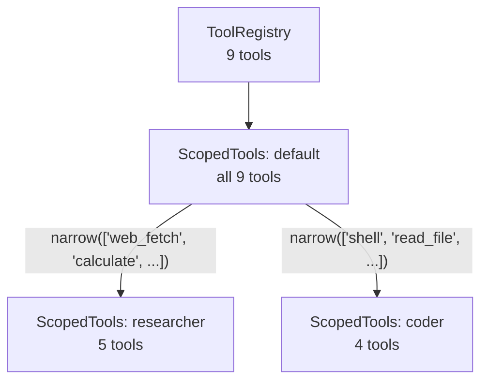

# Tool System

The tool system manages tool registration, policy enforcement, and per-agent tool visibility.

## Tool Trait

Every tool implements the `Tool` trait:

<!-- Code block ignored: trait definition for illustration -->

```rust,ignore
trait Tool: Send + Sync {
    fn descriptor(&self) -> ToolDescriptor;
    fn execute(&self, arguments: Value, ctx: &ToolContext)
        -> Pin<Box<dyn Future<Output = Result<String, ToolError>> + Send>>;
    fn default_policy(&self) -> ToolPolicy { /* defaults */ }
}
```

`ToolDescriptor` provides the tool's name, description, and a JSON Schema for its parameters. The LLM sees these as function definitions.

## ToolError

Tool execution failures are classified by a typed `ToolError` enum for the result returned to the model:

<!-- Code block ignored: enum definition for illustration -->

```rust,ignore
enum ToolError {
    Timeout { secs: u64 },       // timeout; work may have completed
    ApprovalDenied,              // user/gate rejected the call
    Network(String),             // transport failure; effect may have completed
    InvalidArgument(String),     // LLM supplied bad input
    Execution(String),           // generic operation failure
}
```

`From<String>` and `From<&str>` are implemented so tools that produce untyped errors (e.g. via `?` on helpers returning `Result<_, String>`) auto-convert to `Execution`. `ToolError::is_retryable()` returns true for `Timeout` and `Network`, meaning a later call might succeed, not that repeating the effect is safe. The runtime invokes each admitted tool once under its total policy timeout and surfaces failure without automatic resubmission. The built-in MCP wrapper classifies transport-origin errors (HTTP connection failures, subprocess pipe breakage) as `Network`; `web_fetch` does the same for reqwest send/body failures. MCP stdio recovery prepares the connection for later calls without resubmitting the failed call. Explicit HTTP 404 session rejection still reinitializes and retries once; MCP tool annotations do not grant retry permission.

## Tool Policy

Each tool has a policy controlling its risk level, approval requirements, and execution timeout:

<!-- Code block ignored: struct definition for illustration -->

```rust,ignore
struct ToolPolicy {
    risk: RiskLevel,              // Low, Medium, High
    approval: ApprovalRequirement, // Never, UnlessAutoApproved, Always
    timeout: u64,                  // seconds
    sensitive_params: Vec<String>, // redacted in approval display
    rate_limit: Option<u32>,      // max calls per minute (None = unlimited)
}
```

Tools provide a `default_policy()`. Config-level overrides in `security.tool_policies` take precedence. The `ToolPolicyRegistry` resolves the effective policy per tool.

## ScopedTools and Narrowing

`ScopedTools` provides a filtered view of the tool registry:



When agent A spawns agent B, B's tools are computed as the intersection of A's current scope and B's `allowed_tools`. This is transitive -- tools can only decrease down the spawn tree.

<!-- Code block ignored: struct definition for illustration -->

```rust,ignore
struct ScopedTools {
    registry: Arc<ToolRegistry>,
    allowed: Option<Vec<String>>,  // None = all tools; supports globs like "namespace__*"
}

impl ScopedTools {
    fn narrow(&self, child_allowed: Option<&[String]>) -> ScopedTools {
        // Intersects parent's allowed with child's allowed
        // Glob patterns (e.g., "filesystem__*") are expanded against the registry
    }
}
```

Allowlist entries support exact tool names and namespace globs ending in `__*`. `filesystem__*` matches `filesystem__read_file` and `filesystem__write`, but not `filesystem`, `filesystemx`, or `github__pr`. Patterns without the `__*` suffix are exact-name matches. Namespace globs are useful for MCP tool namespaces. They work across all ScopedTools operations: `definitions()`, `get()`, `is_empty()`, and `narrow()`.

## ToolHost

The `ToolHost` trait is the sandboxed capability boundary between tools and the operating system. Tools request capabilities (shell commands, file I/O, HTTP requests) through the host rather than calling OS APIs directly:

```rust,ignore
trait ToolHost: Send + Sync {
    fn request(&self, capability: &Capability, grants: &Grants)
        -> Pin<Box<dyn Future<Output = Result<CapabilityResult, ToolError>>>>;
    fn name(&self) -> &str;
}

enum Capability {
    Shell { command: String, working_dir: Option<String> },
    FileRead { path: String },
    FileWrite { path: String, content: String },
    HttpRequest { url: String, method: String, headers: HashMap<String, String>, body: Option<String> },
}
```

The host enforces grants at the capability boundary — the tool says what it wants to do, the host decides whether to allow it and how to execute it. Two `ToolHost` implementations live in-tree:

| Host                 | Tier       | Isolation                                                                | Status                                                                                                                                                                               |
| -------------------- | ---------- | ------------------------------------------------------------------------ | ------------------------------------------------------------------------------------------------------------------------------------------------------------------------------------ |
| `NativeToolHost`     | Native     | In-process, grant enforcement only                                       | The default host — used for every built-in tool unless `tool_host` selects another.                                                                                                  |
| `BubblewrapToolHost` | OS sandbox | Wraps `Shell` capability invocations in `bwrap`; other caps pass through | `crates/lib/src/bubblewrap_host.rs`, config-selectable via `tool_host: bubblewrap` (fails closed when no working sandbox; `bubblewrap-unsafe-fallback` opts into native degradation) |

Tools (shell, web, file) call `ctx.host().request()` against the trait, so swapping host implementations needs no tool-code changes; which host is used is chosen by the `tool_host` config key.

A separate WASM-tools path (`crates/lib/src/wasm_host.rs`: `WasmEngine` + `WasmTool`) lets a tool itself live in a Wasmtime sandbox while still routing its capability requests through whichever `ToolHost` chaz is using. The engine is wired but the config-driven loader is future work (the module is `#[allow(dead_code)]` today).

## ToolContext

The `ToolContext` is passed to every tool execution:

```rust,ignore
struct ToolContext {
    agent_name: String,                          // current agent
    call_depth: usize,                           // spawn nesting level
    max_call_depth: usize,                       // from agent config
    tools: ScopedTools,                          // narrowed tool set
    profile: ToolProfile,                        // how tool defs are presented
    session: Arc<Mutex<Session>>,                // for tools that write entries
    active_extensions: HashSet<String>,          // per-session active-set filter
    grants: Grants,                              // resolved per-call grants (output of resolve_call_grants)
    session_capabilities: Grants,                // session-wide ceiling (from SessionMeta)
    agent_capabilities: Grants,                  // agent-wide ceiling (from agent config)
    agent_grants: HashMap<String, Grants>,       // per-tool overrides from agent config
    host: Arc<dyn ToolHost>,                     // sandboxed capability boundary
}
```

Before each tool call the runtime calls `ctx.resolve_call_grants(&policy.grants, tool_name)`, which attenuates the tool's policy grant through the session ceiling, the agent-wide cap, and the per-tool override (most-restrictive-wins; see [`Grants::attenuate`](https://github.com/arcuru/chaz/blob/main/crates/lib/src/grants.rs)), and stores the result in `grants`. Tools use `ctx.host()` for system access (shell, file, network) and `ctx.grants()` only for introspection (e.g., `describe_tool` listing available capabilities). `active_extensions` is built by `Server::active_extensions_for` and is what `ScopedTools` consults to hide tools from extensions disabled in this session.

## Adding a New Tool

Tools are published by [extensions](extensions.md). The `Tool` impl is the
tool's _behavior_; the extension is what wires it into the runtime registry.

1. Create `crates/lib/src/tools/my_tool.rs` implementing `Tool`.
2. Add `mod my_tool;` + `pub use` to `crates/lib/src/tools/mod.rs`.
3. Have an extension's `ExtensionInstance::tools()` return your `Tool`. Either
   add it to an existing built-in (e.g. `extensions/core.rs` for general
   tools) or create a new extension in `crates/lib/src/extensions/my_ext.rs` and
   register it in `extensions::all_builtins`.

At install time `install_all` drains every `Global` instance's `tools()`,
the hub publishes them through `tools_for_registry()`, and `main.rs` builds
the runtime `ToolRegistry` from that list. Per-session active-set filtering
hides tools whose owning extension is disabled for the session; policy
overrides in `security.tool_policies` apply on top of the tool's
`default_policy()`.

## Agent-job submission

`spawn_agent` prepares a child session DB and its initial Directive before publishing the ID in the existing watched catalog. A client can submit and observe the handle but cannot admit or run it; the executor validates and participates in that same DB. Status is `Pending` until acceptance or `Rejected` on refusal. There is no parent request key for automatic deduplication: an uncertain creation response requires catalog inspection before another submission.

## MCP process ownership

`McpServer::start` synchronously creates the transport; `initialize` is a separate awaited operation. The MCP registry retains the server and its startup task before initialization or discovery can be cancelled. Startup builds its tool list privately, then publishes tools and Running status under the registry's synchronous admission lock. No registry lock is held over an await. A pending-source guard also retires announcements when an unpolled startup is aborted.

A stdio transport owns a complete child/stdin/stdout generation behind one asynchronous mutex. Close and restart interrupt active I/O before acquiring that mutex. Restart reaps the old generation, waits the existing backoff, then checks terminal admission and synchronously installs all new I/O together. Cancellation leaves either that complete generation or a terminal transport with cleanup ownership retained. Cancelling the recovery handshake also closes admission to the newly spawned generation. Failed tool calls retain their original outcomes and are not replayed.

Each explicit child cleanup uses one monotonic EOF/TERM/forced-reap budget, including its startup join and generation-lock wait. Failures return an incomplete result without removing the owned child or registry entry. Registry close joins startup by reference and removes an entry only after both join and explicit reap succeed. Repeated or cancelled close calls can therefore retry the same owner.

`BuiltServer::try_shutdown` borrows the runtime and reports incomplete cleanup. Terminal callers retry on that same runtime; service supervision borrows the old generation until cleanup succeeds before constructing a replacement. Normal and error one-shot exits take the same shutdown path without changing the bridge result. No extension-instance teardown or detached reaper owns a second copy of cleanup responsibility.

The guarantee is direct-child-only. Inherited stdout held by a wrapper descendant does not prevent direct-child reap, and no process-tree signaling is performed. See [Direct-child shutdown](../user_guide/mcp.md#direct-child-shutdown) for the fixed phase allowances and sequential multi-server scaling.
