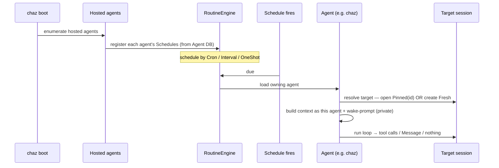

# Agent-Owned Schedules

## Immutable references and reader-first accounting

Definitions and immutable private revisions live on the Agent DB.
A revision names executable and policy material; legacy counters and errors do
not change it. Edits retain the schedule lifetime, while removal followed by
creation starts a new lifetime. Calendar due slots and durable interval
anchor/ordinal pairs identify occurrences independently of engine tokens and
Session request/attempt IDs.

Only the exact addressed Agent can resolve a private reference. Retaining an
old revision does not authorize new delivery: removal, disablement, expiry or a
policy/prompt/target edit makes a not-yet-Included reference ineligible. Input
already Included in a still-running attempt retains its immutable text for that
attempt only; definition edits do not cancel the containing human turn. The resolver returns
private definition material in memory, not a broadcast entry or a grant to
dispatch. Target, key, home and operational handoff checks remain required.

The read-only scheduling preview never initializes a missing Executor or
migrates data. It preserves legacy capacity as a baseline/unknown outcome,
rather than relabelling accepted dispatches as successful executions. The
versioned accounting reader separates successful logical fires, reservations
and handoff history. New lifecycle writers are not enabled by reader support;
the old dispatch writer refuses that version rather than silently overwriting
it. Missing reservation state, unknown versions, inconsistent counts and
unavailable selected storage hold the preview instead of presenting empty
accounting.
There is no live migration or mixed-writer/rollback guarantee: rolling back a
binary does not roll back persisted records.

### Inert preparation and handoff storage

The lifecycle storage APIs prepare an exact revision/clock-slot occurrence and
one delivery ID in the selected Executor. Preparation reserves success capacity;
it is not a successful fire. The matching Session API commits a real `Ack` row
and a versioned `scheduled_inputs` sidecar together, with no attempt start and
no prompt body. Its deterministic delivery-derived row key is a persisted
request identity, not an invented execution attempt. Reopening after a lost
reply reads the same input; a missing half of the record holds instead of
creating another request. Ordinary context, wake and retry selection ignore it.

Handoff revalidates the exact Agent's immutable revision and Pinned target,
then commits the Session link, dispatch audit and original one-shot consumption
together in the operational DB. This commit does not start execution or turn a
reservation into success. A positively unused preparation can release its own
capacity once, including after removal/replacement; an uncertain handoff cannot
be refunded through that API. Neither operation updates the Agent definition.
Legacy spent counts stay an unknown-outcome baseline, unresolved old reservations
require reconciliation, and inconsistent/unsupported records refuse writes.

Fresh preparation records a creation intent before creating its isolated Session.
Only the caller that acknowledges a new intent may create once. After interruption,
the registry searches exact immutable creation names for that delivery: one match
is reused, multiple matches refuse, and an intent with no observable root remains
unknown. A mutable display name cannot hide an existing root or impersonate a
creation marker. The registry repairs that root's schema/catalog/owner attachment,
then durably binds its ID before any inert input or runnable handoff. It does not
register a runtime or start a turn. A bound root cannot be moved to another Session.
Registry/user operations finish before the binding acquires the Agent mutation
boundary; callers reopen the selected identity after attachment before handoff.
Once bound, the root is checked, not repaired: missing or revoked membership
never reopens provisioning. Admission and delivery read the current Session's
auth and home together. Cached roster membership or a leftover delegation alone
cannot replace an active attachment key.

Occurrence version 2 adds this Fresh-root state. Version 1 remains readable for
history/accounting, but an old unbound preparation cannot acquire creation rights
or a new handoff without explicit reconciliation. Older occurrence readers refuse
version 2; deploy compatible readers and stop old writers before activation. These
APIs remain disconnected from timer execution, not permission for live migration.

### Session evidence and logical settlement

The ordinary turn completion transaction writes a prompt-free `turn_outcomes`
record with the request, attempt, completion time and Success, Failure or
Cancelled outcome. It commits with the final entry, terminal transcript and
Completed attempt. A legacy Completed record without this outcome remains
unknown; reading it does not initialize or infer a result. Existing readers can
ignore the new sidecar without changing context or wake selection.

The private input adapter has a separate `scheduled_input_receipts` sidecar.
It binds the inert anchor to one actual attempt: the Ack request for Fresh or
an idle wake, or the containing request for busy Pinned input. Receipt states
reuse the ordinary input meanings: Queued, Accepted, Dispatching, Included,
NotApplied and Uncertain. Included records an observed response, not just a
dispatch intent. A binding cannot move to another attempt or regress an
Included/NotApplied receipt. These records contain references, not wake text.
They are evidence, not authority to dispatch without the ledger and exact-Agent
checks.

Settlement reads the input receipt and terminal outcome from one Session
snapshot and writes the `schedule_settlements` projection with accounting in
one operational transaction. Fresh needs its own confirmed input and successful
terminal outcome; Pinned counts Included, while showing the containing turn's
outcome separately. Neither means the instruction was fulfilled. A known Fresh
failure/cancellation or proven NotApplied input releases its reservation once.
Missing or uncertain evidence retains capacity. Repeating a projection cannot
count twice or refund another occurrence. Late settlement uses the archived
identity without changing an operator-disabled definition, touching a replacement,
rearming a consumed one-shot or erasing dispatch history.

### Private input in the common recorder

A committed operational handoff is the durable successor of clock admission,
not permission to ignore later changes. `authorized_input` requires that exact
occurrence, delivery, Session anchor, current immutable revision and certified
accounting. A consumed one-shot is expected after handoff; a missing generation
or a retained Ack alone is never an alternative authority source.

`bind_active_schedule_input` targets the exact Agent identity captured by the
ordinary running turn. It binds the real containing attempt rather than starting
a scheduled attempt or changing interactive routing. At the existing awaited
model-request boundary, the common recorder resolves references into private
System messages in memory. It checks current keys, membership and home on every
round, and rechecks the definition revision immediately before first dispatch.
After Included, only the exact still-Started attempt may retain the archived
revision; removal or replacement cannot substitute new text or fail that human
turn. Missing archive/key/membership still refuses progression. Ordinary steering remains independent;
private bodies never enter `JobInputRequest.text`, Session entries or summaries.
System instructions are excluded from native autocompaction source ranges.

A `ScheduledInput` transcript boundary contains references and model sequence
only. Its native transaction also changes the matching receipt from Accepted to
Dispatching; required-write failure stops before the backend. An observed response
records Included. Terminal cleanup records positively unused input as NotApplied
and unconfirmed dispatch as Uncertain, without replaying the containing turn.
The regular recorder, signer refresh, cancellation and completion path remain the
only execution/recording path for this input.

Same-attempt exact-wait reconstruction validates the paired transcript and its
matching receipts, reopens current exact-Agent authority and rebuilds the private
System messages in memory at their original call boundaries. It never reruns an
earlier model/tool call. Missing, changed or unavailable references hold the
continuation. Generic wait reconstruction has no private resolver; later independent
turns retain model/tool evidence but never reconstruct the private instructions.

A private checkpoint can be discovered before a restarted process has audited
its selected ledger. `ReconciliationRequired` distinguishes that disposable
readiness condition from a bad checkpoint or revoked authority. The wait is not
marked permanently considered. Once the bounded projection scan has reconciled
the exact Included input and found its unfinished wait checkpoint, it sends a
normal Session wake hint. The usual same-attempt, paired-transcript and current
authority checks still decide readmission; the hint cannot start an unrelated
turn or recover an unpaired dispatch. Lost/full-channel hints are revisited on
the next scan, without holding runtime capacity.

The existing local turn-binding lock spans the private-input scan and ordinary
close commit. Binding cannot slip between them and leave undispatched input on
a normally completed turn. This is local serialization, not distributed fencing.
An active turn that has already closed input refuses a late binding before
writing a receipt. Discovery may deliver that still-unbound handoff as an idle
invocation after the human turn ends. This is not retrying a bound input: an
existing Included, NotApplied or uncertain receipt cannot move to another
attempt, and stopping the containing turn never restarts it.

Older extensible transcript readers preserve this boundary as Unknown and hold
unsupported continuation rather than interpreting it as ordinary input. Compatible
readers must precede activation; rollback does not remove written records.

### Targeted idle and Fresh admission

`deliver_schedule_input` validates an already committed handoff, then binds exact-Agent
active Pinned input or tries the ordinary runtime semaphore for an idle invocation.
A different active Agent, a busy processing reservation or full capacity leaves
it pending without an extra task, permit wait or Started record. The coordinator
must rediscover pending handoffs; this return is not a delivery receipt.

After acquiring capacity and the existing per-session processing reservation, the
adapter reopens current signing identities and revalidates source/target authority.
Started and its reference-only input receipt share one native Session commit under
the real Ack request. A repeated/lost start acknowledgement cannot create a new
attempt or rebind an old receipt. Unknown prior start evidence holds instead of
implicitly retrying. The ordinary runner owns context, awaited recording,
cancellation, terminal outcome and cleanup. Standalone private invocations have
no interactive approval, generic resume or resumable context snapshot. Automatic
finals remain local because the Ack has no external-origin message. Explicit send
tools retain their normal checks.

A verified bound Fresh root can be registered after restart; an ordinary Pinned
reference cannot register a closed target or reattach a revoked member. Targeting
an idle accepted Agent-job Session cannot bypass that job's parent/participation
protocol. Pinned routing overrides, backend, watchers, completion signals and
parent scopes are not rewritten or inherited as root authority.

RoutineEngine admission publishes these references into ordered handoff discovery.
An inert anchor alone is still not runnable. Legacy direct-call compatibility remains
separate until its callers have been migrated; it cannot write versioned accounting.
These APIs authorize no live migration or historical replay.

### Local serialization and paged discovery

Definition edits, operational admission/handoff, release and settlement use the
same process-local Agent mutation boundary, including independently reopened
handles. The existing timer writer uses it too; there is no separate Server-only
accounting lock. Registry identity/storage setup finishes before entering that
boundary to avoid reversing the registry-user lock order. Execution, target
idleness and runtime capacity waits never hold it. This serializes local writes,
not synchronized remote revocation or two processes sharing a home identity.

`OccurrenceScan` reads prompt-free identities from one pinned selected-ledger
snapshot in native persisted-key pages of at most 128 rows. Missing initialization
is distinct from an empty initialized scan; unavailable storage, a wrong Agent or
an unsupported/malformed page refuses without advancing the cursor. Concurrent
writes appear in a new scan, not a mixed-head result. Restarting discovery may
repeat observations but never allocates a delivery or authorizes execution.
Consumers still need current source, authority, exact handoff and accounting
checks. A page is not proof of delivery, global history consistency or capacity.

### Ordered handoff discovery

A handoff commits its Agent-wide publication ordinal, `schedule_handoff_head`,
`schedule_handoff_order` index, fire audit and occurrence together in the selected
Executor. This order is independent of wall-clock changes, preparation order,
hashes and delivery UUIDs. The index contains references only, not instructions or
execution outcomes. Repeating a committed handoff returns its existing ordinal.
The first indexed publication requires a completed snapshot audit proving no
indexed occurrence already exists, including other schedule lifetimes. Legacy
unindexed history remains unchanged and is never replayed. A missing head or link
on an indexed occurrence holds accounting, not a reset to ordinal one.

Occurrence version 3 adds the publication ordinal. Earlier strict readers refuse
it, so compatible readers and coordinated writers must precede activation; binary
rollback does not remove the index or its inputs. Version 1/2 history remains
readable but does not become an automatic delivery source. Inspection never
initializes the head or a missing selected Executor.

`HandoffScan` reads at most 128 indexed publications from one immutable snapshot,
validating consecutive ordinals and their exact occurrence/handoff links. A bad
page does not advance. Later publications appear on a later scan. On the existing
processing loop, the resident executor advances a bounded scan and tries the
ordinary common delivery adapter. There is no task per occurrence, extra worker
pool or capacity wait. Startup, shutdown and executor authorization still apply.
Only one unconfirmed input per target is offered in each pass; later inputs wait
for its Included or terminal evidence rather than sorting private messages by
UUID. Other targets continue while a target is full, busy or awaiting a response.
A failed/uncertain or stale read holds that target for the pass, never grants a
retry. The next scan rediscovers pending input after lost notifications/cursors;
already bound attempts are observed, not restarted. Closed-boundary rebinding and
interruption retry remain separate policy work.

### Durable clock successors

`prepare_schedule_clock` pins a timer-authorized slot in the selected Executor
before preparing its inert Session input. Occurrence version 4 carries the
trigger, clock position and handoff successor; `schedule_clocks` holds the exact
revision's current cursor. Preparation writes both records atomically. The caller
must still retain and revalidate its disarmed engine token and target authority.
An arbitrary slot or a missing engine generation is not permission to admit work.

Handoff commits the next cursor with the occurrence, fire audit and publication
index. Intervals retain their admitted dispatch anchor and next ordinal; cron
retains the next calendar slot after admission; a one-shot has no successor.
Neither model completion nor a later acknowledgement supplies a new anchor.
Repeating a preparation or committed handoff returns the original identity.
`schedule_clock_cursor` reads the persisted successor without initializing it,
starting work or writing a peer-local projection. A restart can therefore inspect
the same successor even if that projection was never written.

Clock records contain no prompt text. Reads check the immutable definition,
current cursor and exact predecessor handoff. Accounting audits check clock links
on all timed occurrences, including other lifetimes, before certifying mutation.
A missing/conflicting cursor holds work rather than resetting its lineage.
Released preparation stays released at its original slot; it does not acquire a
retry or a new ordinal. Existing untimed occurrences cannot be relabelled timed.
Version 1–3 history remains readable; earlier strict readers refuse version 4.
Compatible readers and coordinated writers are required before activating it, and
binary rollback does not roll back these records.

No-op Agent reload applies its heap replacement under one lock and preserves the
slot, generation and armed/disarmed state for every trigger. Definition lifetime
and revision are part of that identity: a same-text replacement or policy edit
invalidates an old callback. A metadata-only interval edit within one lifetime
keeps its pending slot but receives a new generation. Fallible storage reads
finish before replacing healthy engine state.

The production timer carries the exact lifetime, revision and due slot from its
disarmed snapshot through both guards. It prepares a reservation, one known Fresh
root if needed, and an inert reference-only Session Ack before committing handoff.
It does not wait for model completion, target idleness or runtime capacity. Ordered
discovery supplies active Pinned input or a targeted idle/Fresh turn through the
common runner. Capacity is acquired before Started; a full runtime leaves committed
input queued without a task or waiter per occurrence.

The handler reads back the durable cursor before acknowledging its exact engine
token. A lost acknowledgement retains the original occurrence and Session/root;
reopening the engine uses that persisted successor, never a new process-time anchor.
The peer-local interval timestamp is only a repairable projection. A persisted
successor wins over an old in-flight callback during reload. Conversely, a prepared
occurrence retains its OWN final capacity reservation through a true no-op reload.
Removed/replaced/disabled sources and revoked membership cannot publish an inert
input prepared before the change. Current authority is checked again at delivery.

A failed preparation remains disarmed at its original slot. Bounded accounting
maintenance may readmit that same inert preparation under the engine's finite
failure bound; it cannot allocate a new occurrence or retry a started model turn.
Bounded interruption recovery remains unfinished. A late
input refused at an already-closed boundary remains unbound for targeted idle
delivery; an uncertain bound input is not silently retried. No live migration, historical replay or cross-DB transaction
is provided here.

### Missed windows

The engine records its own start instant. A slot loaded from a persisted cursor
whose due time precedes that instant is carried to admission as `missed`. Slots
that fall due while the engine runs are never missed, and an unseeded first slot
(no handoff yet) keeps its computed due time. Admission first checks target
authority, then `miss_schedule_clock` under the shared scheduling boundary. An
existing occurrence for the slot returns `Owned` and continues as ordinary
preparation, so a prepared or released slot is never reclassified.

With effective catch-up off, one transaction writes an immutable prompt-free
`schedule_missed_windows` record (first/last due, slot count, exactness) and
moves the cursor to the trigger's successor at the observation time. No
occurrence, reservation or Session input is created; the engine token is then
acknowledged with that successor. Cursor version 2 stores `missed_from`, the
slot the predecessor handoff named, so link validation still checks the exact
handoff. A later handoff writes version 1 again. Repeated outages keep the
original `missed_from`. Earlier strict readers refuse version 2.

With catch-up on, the record is written with `CaughtUp` and the slot proceeds
through normal preparation, expiry and capacity checks. The handoff successor
already coalesces the window: cron moves to the first slot after admission and
interval anchors at admission. Migrated legacy intervals default to catch-up on;
everything else defaults off. Records are idempotent per slot and disposition and
contribute nothing to accounting; their store is still part of the accounting
audit's mutation set. `CaughtUp` means a catch-up slot was selected, not that its
handoff or turn completed.

A live token can read back its already committed handoff or skipped successor
after a lost acknowledgement. This does not prepare another input or write a
second missed window. A cold interval omitted while its last slot was reserved
can restore its saved next slot after a known capacity release; the definition
and cursor still control eligibility.

### Bounded accounting reconciliation

`reconcile_schedule_accounting` inspects one native page per call, with a limit
of 1–128 rows. Occurrences, legacy reservations, handoff history, settlement
links and the exact accounting state all come from the same operational snapshot.
Cross-record checks use point reads; a failed page cannot advance. Missing state,
unknown versions, duplicate deliveries, unknown legacy handoff lifetimes and
inconsistent success/reservation/history counts still refuse certification.
No partial scan, missing initialization or unavailable selected Executor creates
capacity. Reconciliation is read-only, not legacy migration or execution authority.

Completed audits are disposable process-local certificates bound to the Agent,
selected ledger, schedule identity/lifetime and exact snapshot. Preparation,
handoff, release and settlement require that certificate and use point operations
rather than scanning history. Known lifecycle commits advance it by their exact
committed entry and validated delta. Unexpected scheduling or metadata writes
discard it; unrelated Executor job activity does not starve an in-progress audit.
A bounded, identity-bound native-entry walk proves that every new ancestry path
reaches the audited frontier without changing accounting tables or metadata,
including divergent branches. Larger deltas retain progress but cannot authorize a
mutation until the exact observed head is checked. Each reconciliation call reads
at most its row limit plus that many ancestry entries; a mutation's refresh is
limited to 16 entries and otherwise refuses for reconciliation. Commit failure or
cancellation discards certificates before another effect can use them. Restart
reconstructs observations from history, never resets capacity. No certificate is
persisted in another store, and none promises distributed fencing.

The resident executor's ordinary processing loop drives one accounting page per
second, fairly cycling current hosted definitions outside timer admission. It
holds no runtime capacity while observing. For an enabled definition whose current
home, membership and registered target permit admission, it selects missing owned
storage outside the timer callback, then reconciles before readmitting an inert
preparation. It never replaces a present unavailable reference or starts a turn.
Read-only inventory/preview does not perform this initialization. Alongside it, a bounded projection scan reads
at most one occurrence page or advances one occurrence per tick. It reopens current
identities, reconciles archived accounting and projects exact Session evidence even
after definition removal. Unavailable/conflicting records retain reservations;
they cannot authorize another invocation. The common recorder also awaits point
projection after Included, before further effects, and attempts final projection
after Session completion. Failed final projection is recoverable from that Session,
not permission to redeliver.

This maintenance is not another execution scheduler. Timer admission uses the
versioned lifecycle and common delivery path. Both public schedule-dispatch entry
points require the live clock snapshot and generation; neither executes legacy
prompt/target payloads. The duplicate turn runner and its activity/recording path
are removed. Legacy record constructors exist only in reader tests; historical
rows and their conservative baselines remain readable. Finite recovery allocations
and rollout coordination remain unfinished.
All scheduling writers must support the new protocol before activation. There
is no replay or live-migration permission, mixed-writer support or cross-DB
atomicity. Rolling back a binary does not remove the new sidecars or projections.

> Schedule definitions and ownership references live on the Agent DB.
> One selected owned Executor DB records reservations and dispatch handoffs;
> the target Session records execution history and usage through the ordinary
> durable turn recorder. See [Durable scheduled turns](../architecture/react.md#durable-scheduled-turns)
> for the commit boundaries and restart limitations.

### Delivery retry and interruption recovery

A known failed Fresh turn or unsuccessful Pinned delivery can be retried by
an exact predecessor delivery and Session attempt. An Included Pinned input
already counts as success. Explicit stop is not an ordinary failure. The
executor checks the current revision, exact Agent and target Session, terminal
Session evidence and remaining capacity. An unacknowledged command is retried
with the same predecessor IDs; a predecessor can have only one successor.

Retry publishes a separate inbound reference without changing the clock or
provisioning another Fresh session. The original occurrence retains its
dispatch history. Its latest delivery determines success/reservation counts:
a released slot must be reacquired; if a Pinned delivery was uncertain but
its containing attempt definitively failed, the operator can retry against
the same held slot. The authorizing evidence remains on the predecessor.
Bounded accounting validates each link and refuses a missing predecessor or
latest delivery. A pre-retry reader refuses the new ledger row shape; upgrade
readers before enabling writes.

An obsolete handoff can be closed without binding only when the Session still
has the exact inert input and no Started attempt or receipt. The Executor marks
it unused and refunds its reservation once, keeping publication history intact.
Unreadable or conflicting evidence still holds that target's ordered work.

`interruption_retries` is an opt-in bound on the next delivery ordinal. Eligible
bindings record their home key and executor generation with the Session
receipt. On restart, the existing projection pump can authorize a successor
only for the same home key, an older generation, and an exact interrupted
request with no terminal outcome, recorded stop or wait checkpoint. It first
projects the predecessor's evidence; allocation retains the held reservation.
The bound, ordinal, predecessor, dispatch audit and ordered publication are
checked in the same ledger commit. A later restart sees that ordinal, not a
fresh budget. The same checks hold at delivery so a newer attempt or late
stop can prevent execution even after allocation.

Fresh recovery uses the existing request-generation check for its old attempt
in the bound session; it does not use generic Ack selection or create a second
root. Pinned recovery can only submit private input, not replay a human turn.
Already live attempts on this executor and any checkpointed wait stay outside
this policy. An older generation isn't proof of exclusion under concurrent
runtimes using the same key. The existing one-executor-per-session assumption
still applies; earlier model/tool effects may repeat after interruption.

## Historical predecessor (superseded)

The following sections retain the original standalone-path design and migration
rationale. They are historical, not the current execution/accounting contract;
the common producer/runner and immutable-reference sections above supersede them.

### Summary

A schedule belongs to an Agent, not to a session. Chaz hosts one or more
Agents and loads their schedules at boot. The Agent's home daemon is the only
executor: Fresh schedules use the Agent-level home, while Pinned schedules use
the Agent's home for the target session. Other daemons may hold the synced
schedule row, but they skip its fires.

When a schedule fires, the home daemon loads the owner, resolves its target
(an existing pinned session or a new session for this fire), builds context as
that Agent, passes the wake prompt as private invocation input, and runs the
Agent's loop. The Agent may use tools, then completes with a normal local final.

Routing is intrinsic: the schedule names its owner, so there is no
"resolve who responds" step. This replaces the current model where a
scheduler writes a generically-routed `Directive` entry into a session.

## Problem

Today scheduled wakes are **session-owned**: `Routine` rows live in each
session DB's `routines` table; `HeartbeatPayload` merely _names_ a target
agent; `RoutineEngine` discovers work by scanning sessions; the
`HeartbeatRoutineHandler` writes a `Directive` entry that
`process_session` then routes through `resolve_agent_for_entry` (override →
@mention → host → first-authorized → default). Consequences:

- In a multi-agent session a wake "for `@beta`" can be answered by whoever
  the generic resolver picks — the target is advisory, not binding.
- Schedules don't travel with the agent. An agent's schedule is scattered
  across the session DBs it happens to have been used in.
- The wake-prompt is a broadcast `Directive` entry every participant sees,
  even though it's a private nudge to one agent.
- A woken agent writes a local terminal `Message`; tools can run before
  that final without creating an external post.

## Model

A **Schedule** is owned by an agent and stored in that agent's Living-Agent
DB (the same signed eidetica DB that already holds the agent's
`config`/`meta`/history). Schedules therefore sync and travel with the agent
across peers, exactly like its config.

```text
Schedule {
    id:       String,
    schedule: Cron(expr) | Interval(period) | OneShot(fire_at),
    prompt:   String,                 // the wake-prompt
    target:   Pinned(session_db_id)   // fire into this existing session
            | Fresh,                  // create a new session per fire
    enabled:  bool,
    expires_at: Option<DateTime>,     // lifecycle bound (Gap 4)
    max_fires:  Option<u32>,          // lifecycle bound (Gap 4)
    lifetime: Option<String>,        // stable across edits; new on recreation
}
```

- **Pinned** — "resume _this_ session at 9pm and check in." The agent's
  home/default session is **not a separate concept** — it is just a Pinned
  schedule whose `session_db_id` is that session.
- **Fresh** — "every 9pm, go do X" — an autonomous recurring task. Each
  fire creates a new session owned by the agent; no other participants, so
  the multi-agent wake-chain (see [Autonomous Agents in Shared
  Sessions](./autonomous_agents.md)) cannot start there.

The `target` choice is made at create time and recorded in the schedule.
Operational counts, one-shot consumption and terminal retirement live in the
Agent's selected Executor DB, not in the definition. Legacy Agent counters
remain read-only baselines; editing a definition does not copy the effective
count back onto the Agent.

### Lifecycle bounds (Gap 4)

A `Cron` or fixed-delay `Interval` schedule is infinite by default; `OneShot` retires itself. An interval first fires one period after creation and then one period after each successful handler dispatch; its persisted dispatch anchor preserves that timing across restarts. Agent turns run asynchronously, so intervals do not imply non-overlap. Two
optional bounds make _finite recurring_ work expressible without a third
trigger type:

- `expires_at` — an absolute instant after which the schedule stops.
  Robust across restarts for free (absolute time).
- `max_fires` — retire after N reserved or accepted dispatches. The
  selected Executor DB holds the counter, so it survives restart and
  home-peer changes without per-fire Agent writes.

The fire path reserves a slot before creating a Fresh session. A proven
pre-dispatch refusal can release that exact reservation. Accepted handoffs
remain spent even if execution fails or is cancelled. Bound retirement is
computed from the current definition and operational count; it does not
change operator enablement. `register_agent` reads this effective state so
restarting does not reset the bound.

One-shots reserve a slot too. An accepted handoff consumes the lifetime and
hides its definition from ordinary inventory. A pending reservation holds it
without automatic replay. Re-adding a consumed ID creates a new lifetime;
modifying its hidden definition is rejected. Physical definitions remain so
config bootstrap cannot silently recreate consumed work.

This deliberately leaves the engine's in-memory cron slot ticking until
the next reload/restart — each post-bound tick simply early-returns at
the fire path. Correctness lives at the DB-backed chokepoint, not in the
heap; this avoids threading three more fields through
`Routine`/`schedule_to_routine` and the dual-write fragility that the
existing in-memory-only `max_failures` disable already exhibits. The
cost is a cheap periodic no-op until reload — acceptable and bounded.

### chaz as runtime



The engine's discovery inverts: it enumerates **hosted agents** and reads
their schedule registries, rather than scanning session DBs for routine rows.
The dispatch path checks both hosting and home ownership. A daemon that does
not host the Agent skips immediately. A co-owner also skips unless its local
key matches the Agent-level home for Fresh work or the session-level home for
Pinned work. These gates assume one configured home daemon; there is no
distributed lock or automatic failover.

### Intrinsic routing & private wake-prompt

Because the schedule belongs to the agent, the fire path invokes that agent
directly and never consults `resolve_agent_for_entry`. The wake-prompt is
_invocation-scoped context_ for that turn — not a broadcast `Directive`
entry. The agent's resulting tool calls and any `Message` are written to
the target session as normal entries (audit + visibility land where they
belong); the prompt itself is not a shared entry.

### Execution path (decided: standalone; never touches the target's runtime)

A fired schedule's turn runs through a **standalone execution path**, not
the interactive `process_session` → `SessionRuntime` → `spawn_agent_task`
machinery. This is a hard requirement: a `Pinned` target **may be a live
session** a user is actively conversing in, and the schedule turn must not
mutate or hijack that session's `SessionRuntime` (its `agent_override`,
backend, completion channel, watcher wiring). Reusing
`register_child_session` (which pins the agent by _overwriting_
`SessionRuntime.agent_override`, `server.rs:369`) is therefore only valid
for `Fresh`; it is **forbidden for `Pinned`**.

The standalone path:

1. **Host check** — `agent_index.find_by_id(owner)`; not hosted ⇒ skip
   (the owning peer fires it). This is the dispatch gate.
2. **Resolve session** — `Fresh`: create a new session
   (`source = schedule:<owner_db_id>:<schedule_id>`) and attach the owner.
   `Pinned`: open the existing session; idempotently (re)attach the
   owner so it's authorized; if the session is gone or the owner can't
   be a member, **self-skip + log** (membership-at-fire).
3. **Serialize, don't hijack** — acquire the session's existing
   per-session `processing` lock so the schedule turn cannot interleave
   entries with a concurrent interactive turn. If the session is busy,
   skip this fire (cron will come around again; a missed one-shot is
   logged) rather than block or run concurrently. The lock is the
   shared serialization point. The turn also registers its ordinary
   live-attempt and cancellation handles, but does not overwrite the
   target's `SessionRuntime`, so interactive routing is unaffected.
4. **Prepare and acknowledge dispatch** — load and hydrate the owner,
   commit an inert timer-origin `Ack` and Started attempt in the Session,
   and build context with the wake prompt as private invocation input.
   The selected Executor then commits the handoff link and consumes the
   reservation. Only then does `dispatch_agent_schedule` return success
   to the engine. These two database commits are not atomic together.
5. **Run and record the turn** — the tracked task uses the cancellable
   ReAct runtime and `SessionRuntimeRecorder`. Model responses commit
   before tools; results commit before further model work. Final status
   and usage belong to the linked Session attempt, never the timer log.
   Required recording failures stop progression without replay or refund.
6. **Retain lifecycle evidence** — the engine drops one-shots from its
   heap; consumed definitions remain on the Agent and their operational
   evidence remains in the Executor. Execution completion does not revise
   timer acceptance.

Implementation note: the standalone runner is a focused, separate method
— it deliberately does **not** modify `spawn_agent_task`, to keep the
interactive hot path untouched. Some assemble/execute sequence is
duplicated; that cost is accepted to isolate risk from every
interactive turn.

### Local final

An invoked schedule turn writes a normal local final. Empty model output is
reported as an error, not a valid completion. Tool results remain audit
entries; neither they nor the local final automatically post to Matrix.

### Membership at fire time (Pinned only)

A Pinned schedule targeting a session the agent is no longer a member of must
**self-skip** (logged, not errored) when it fires. This replaces today's
detach-side cleanup (`detach_agent_from_session` sweeping session routine
rows, `sweep_for_agent`): the check moves from "clean up on detach" to
"verify membership on fire," which is correct for an agent-owned object.

## Failure Modes & Mitigations

| Failure                                                      | Mitigation                                                                                                                                                          |
| ------------------------------------------------------------ | ------------------------------------------------------------------------------------------------------------------------------------------------------------------- |
| Schedule fires for an agent this peer doesn't host           | Host check is the dispatch gate — silently skip (owning peer fires it)                                                                                              |
| Pinned target session deleted / agent detached               | Membership/existence checked at fire → self-skip + log                                                                                                              |
| Fresh fires accumulate sessions unbounded                    | Fresh sessions are normal sessions subject to existing lifecycle/retention; cron cadence is author-chosen                                                           |
| Self-scheduled tight cron or interval self-sustains activity | Controlled by chosen cadence; **not** the chat-room burst budget or `max_spawn_depth` (which only limits nested delegation). Revisit a min-interval guard if abused |
| Empty model final                                            | Runtime reports an error instead of silently dropping the turn                                                                                                      |

## Migration

No migration shim was built. The DB starts from scratch (pre-release
`vibe` branch), so the legacy session-routine path was **deleted
outright** rather than migrated:

1. YAML `schedules:` now imports as agent-owned `Schedule`s (Pinned to
   the resolved session), owned by an explicit `agent:` or the peer's
   default agent.
2. `HeartbeatPayload`, `HeartbeatRoutineHandler`, the `scheduler`
   extension + `SchedulePayload`, and `crates/lib/src/heartbeat.rs`
   (`sweep_for_agent`) were removed.
3. Detach/delete cleanup is replaced by the fire-time membership check
   in `fire_agent_schedule`.

## Naming (post-merge reconciliation)

The user-facing vocabulary is unified on one word: **`schedule`**. The
`Schedule` type, the `schedule_add|modify|remove|list|once` tools, the
`/schedule` command, the `schedule` extension, and the YAML `schedules:`
key are all the same word. "Timer"/"heartbeat" are retired (a timer
connotes a countdown alarm; this is a recurring or future invocation of
an agent — a schedule). For current commands, see
[Schedules](../user_guide/agents.md#schedules).

## Open Questions

1. Schedule **id** scope — unique per agent, or globally? Per-agent is
   sufficient and matches ownership.
2. Should `Fresh` sessions be tagged (source = `schedule:<agent>:<id>`) so
   they're discoverable/groupable? Proposed: yes, mirrors `spawn:` tagging.
3. **Partially resolved (Gap 4).** Per-schedule lifecycle bounds
   (`expires_at`, `max_fires`) landed, so finite recurring work is
   expressible and a self-scheduled schedule can no longer be
   _unbounded by construction_. A peer-wide **operator ceiling**
   (min-interval / max-schedules-per-agent enforced against the
   operator's will) is still deferred: it's a real policy decision
   (which knob, enforced where, interaction with synced schedules) and
   is intentionally not guessed.
4. Editing a schedule — `schedule_modify` analogue on the agent DB; does a
   schedule edit need a dedicated audit entry? Likely no.

## Implementation Touch Points

- ✅ Agent DB: `schedules` definitions and the selected `scheduling_executor` reference; old `schedule_fires` rows remain readable. Executor DB: reservations, counts, retirement and dispatch-time `ScheduleFire` links.
- ✅ `routine` engine: `RoutineScope::Agent`, `AgentSchedulePayload`, `Schedule→Routine` conversion, `register_agent`/`reload_agent`/`deregister_agent`, boot wiring.
- ✅ `server.rs`: conditional terminal `Message` (skip when body empty).
- ✅ **Standalone fire path**: `agent_schedule` awaits `dispatch_agent_schedule` through durable acceptance, then the tracked task runs with ordinary Session recording and cancellation.
- ✅ **Tools/commands repoint** (Stage 5): All schedule tools (`schedule_add`, `schedule_modify`, `schedule_remove`, `schedule_list`, `schedule_once`) and the `/schedule` command now write agent-owned `Schedule`s with `target: Pinned(current session)` by default; `target: fresh` option added. `notify_agent_schedules_changed` bridge syncs the engine after mutations. Tools and commands use the scoped `AgentStateAdmin` capability to open Agent definitions together with their selected scheduling ledger.
- ✅ **Detach cleanup retired** — fire-time membership check in `fire_agent_schedule` replaces the sweep in `detach_agent_from_session`.
- ✅ **Legacy path deleted** (no migration — greenfield): `scheduler` extension, `HeartbeatPayload`/`HeartbeatRoutineHandler`, `crates/lib/src/heartbeat.rs`. YAML `schedules:` imports as agent-owned `Schedule`s.
- ✅ **Naming reconciled**: one word `schedule` end-to-end (type, tools, command, extension, YAML key); `/schedule list` is session-wide across attached agents.
