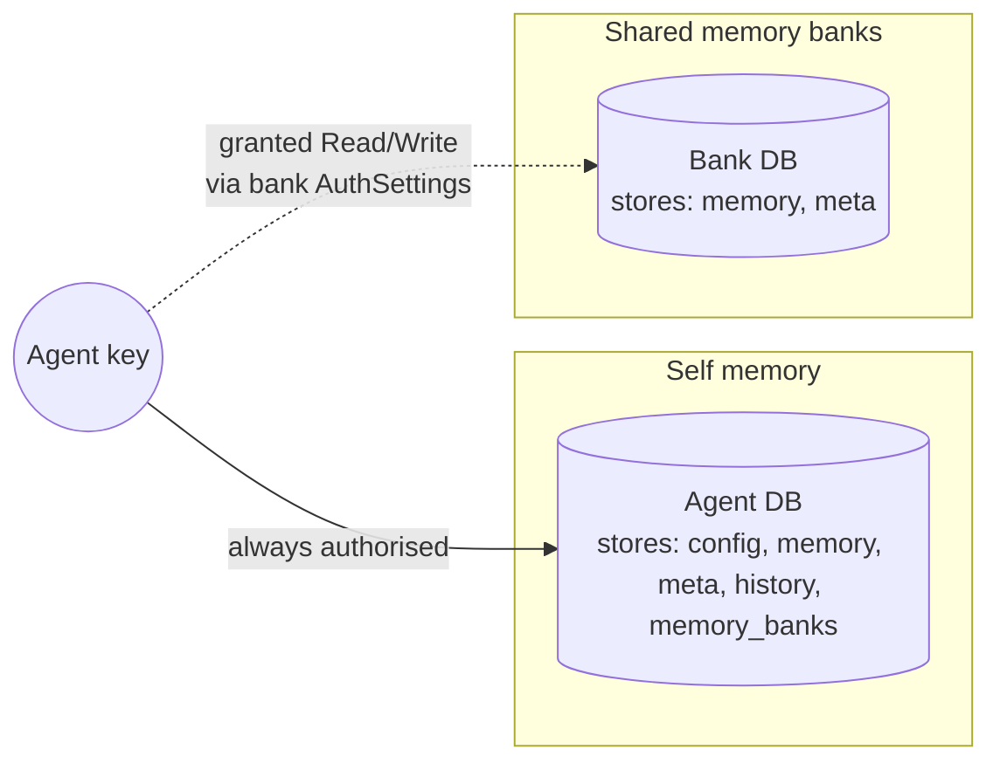
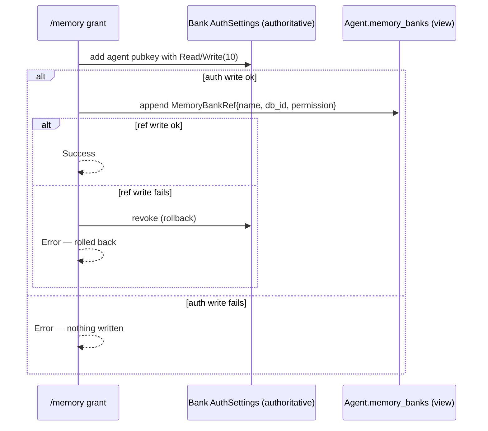
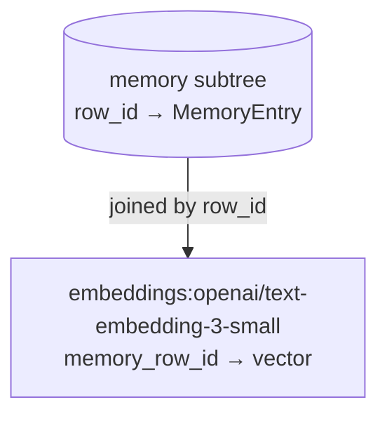

# Memory

Chaz agents have persistent memory that survives restarts and travels across peers via eidetica sync. There are two flavours, but they're the same primitive under the hood: **a `memory` Table inside an eidetica DB**. What changes is _which_ DB, and _who holds the key_.



## The Two Kinds

| Kind                   | DB                                                | Tool call                                   | Who can read/write                                            |
| ---------------------- | ------------------------------------------------- | ------------------------------------------- | ------------------------------------------------------------- |
| **Self memory**        | Agent's own DB                                    | `remember` / `recall` (no `bank`)           | Just the agent — it owns the DB key                           |
| **Shared memory bank** | Standalone `MemoryBankDb` (or another agent's DB) | `remember` / `recall` with `bank: "<name>"` | Anyone granted `Read` or `Write` on the bank's `AuthSettings` |

"Another agent's DB" works here because every Agent DB _is_ a memory bank — it has the same `memory` Table. Granting agent B Read on agent A's DB means B can `recall` from A's notes.

## Why It Looks This Way

Earlier iterations had a `MemoryGrant` capability flag and a `global_memory` store in the peer-local group DB. All of that was removed. The current model is **authorisation by key possession**: an agent can read or write a bank iff eidetica's `AuthSettings` on that bank's DB says so. There is no app-level permission flag to forget to check — opening the DB with the wrong key just fails.

Two consequences worth noticing:

- **Self memory is not grant-gated.** If `remember`/`recall` is in the agent's `allowed_tools`, it works on its own memory. An agent always holds its own DB key.
- **Cross-agent sharing is always a bank grant.** There is no shortcut for "give alpha access to beta's memory" other than granting alpha on beta's DB (or a shared bank).

## The Tools

The `memory` extension supplies the following tools. An Agent with an `allowed_tools` list needs an entry for each tool it uses.

### `remember`

```json
{
  "key": "project.chaz.deadline",
  "value": "2026-06-01",
  "tags": ["project", "chaz"]
}
```

Writes to the agent's own memory. Optional `tags: [string]` attach free-form labels for later filtering. Add `"bank": "<name>"` to write to a shared bank where the agent has Write.

If an [embedding backend](configuration.md#embeddings) is configured, every write also embeds `key + " " + value` and stores the vector in the same DB under `embeddings:<provider>/<model>` — joined to the memory row by the row ID. This happens in one transaction. If the embedding API fails, the memory is still stored; only the vector is missing.

### `recall`

```json
{ "query": "deadline", "tags": ["project"], "limit": 5 }
```

Searches the agent's own memory. Add `"bank": "<name>"` to search a bank. All three extra fields are optional:

- `tags: [string]` — AND-filter; only entries carrying every listed tag are considered.
- `limit: integer` — cap on returned entries (default 10).
- `query: ""` — empty string returns by recency (handy with a `tags` filter).

See [Searching memory](#searching-memory) below for how ranking works.

### `list_memory_banks`

```json
{}
```

Lists every bank the agent can see, with the permission level. Always includes `self`. Designed to be called on-demand when the agent needs to discover what's available — same pattern as `describe_tool`.

### Session excerpt tools

| Tool                      | Arguments                                                  | Result                                                                                                                               |
| ------------------------- | ---------------------------------------------------------- | ------------------------------------------------------------------------------------------------------------------------------------ |
| `browse_sessions`         | `{}`; optional `cursor`                                    | A page of readable session DB IDs in `sessions`, with any known names in `untrusted_session_names` keyed by ID.                      |
| `browse_sessions`         | `session_db_id`; optional `cursor`                         | Up to eight chat excerpts in conversation order, with their native message IDs, senders and timestamps.                              |
| `import_session_messages` | `session_db_id`, `bank`, `bank_db_id`, `message_ids` (1–8) | Copy those messages to the named standalone bank. The receipt identifies both databases, the selected IDs and how many rows changed. |

### A copy has its own audience

The responding Living Agent must have an active direct key in its invoking session with Write, and at least Read in the source. A session can be read by ID without appearing in the Agent's registry. A registry entry, an Account key on the host, a wildcard grant or an old cursor is not the Agent's grant. Import also needs an unambiguous writable bank reference on the Agent and current Write on that bank. Neither tool creates grants.

Browsing is passive: it neither resumes the source session nor writes to a bank, but it does record returned names and excerpts in **this** conversation. Names are read from the source sessions, not the host's session catalog, and cut to 128 UTF-8 bytes. Unnamed sessions still appear by ID. Descriptions are not returned. Treat names and excerpts as data, not instructions. Importing makes a separate copy readable in the destination bank; it can turn up in recall, including auto-recall. Source revocation stops future reads and refreshes; it cannot withdraw an earlier tool result or bank copy. Enable these tools only for Agents you intend to make those choices. No private session is imported just because an Agent is attached to it.

Only plain `Message` rows from legacy session history are eligible. Tool calls, results, directives, summaries, routing data and provider metadata aren't returned. Text is limited to 768 UTF-8 bytes, the sender to 128 bytes. The bank stores a labelled, quoted excerpt, not a generated summary or an instruction. Import calls no embedding provider. Its entries participate in lexical `recall` under the `session-excerpt` tag.

Browsing excerpts and importing messages both refuse sessions with [ConversationStore v1](../architecture/sessions.md#conversationstore-v1-reads-and-fenced-writer-fixtures) traces instead of falling back to legacy rows. Supporting that format requires a production writer and a `HistoryRead` API that provides stable message IDs and timestamps.

### Walkthrough: find a session and inspect it before making a copy

1. In a session where the Agent participates, call `browse_sessions {}`. If the result is `{"sessions":["T","S"],"untrusted_session_names":{"T":"scratchpad","S":"lighthouse-planning"},"next_cursor":null}`, choose `S` for the lighthouse discussion. The examples abbreviate database IDs as `T`, `S`, and `B` and a message ID as `M`.
2. Call `browse_sessions {"session_db_id":"S"}` and read the adjacent chat messages in `untrusted_message_excerpts`. On dated history, messages are ordered by timestamp, then native row ID when timestamps tie. For another page, send the same arguments plus the returned `cursor` (the value of `next_cursor`). Follow the cursor even after an empty page: listing can skip unreadable sessions, and ordered inspection may still be scanning. `null` means end. An excerpt cursor reads a fixed snapshot, not a watermark for new messages. If the source grant was revoked, the next request reports `session or cursor unavailable; restart without cursor and check current grants`. If you only wanted to inspect, stop here.
3. To keep an excerpt, select its `message_id` (`M`). Call `list_memory_banks` and take the DB ID (`B`) for `notes`, then call `import_session_messages {"session_db_id":"S","bank":"notes","bank_db_id":"B","message_ids":["M"]}`. If the Agent has only Read there, the tool reports `import unavailable; check the selected chat IDs and current session/bank grants`. Choose a bank already writable by this Agent; the tool doesn't upgrade the grant.
4. With a writable `notes`, the result is `{"bank_db_id":"B","changed":1,"message_ids":["M"],"session_db_id":"S"}`. Call `recall {"bank":"notes","query":"lighthouse","tags":["session-excerpt"]}` for a message mentioning a lighthouse. Its key is `session:S/message:M` and its value identifies the original sender and timestamp.
5. Save the source, destination and selected IDs if you need to retry. Reuse the same bank ID: if `notes` now points elsewhere, the request fails without copying. The same call to the same bank returns `"changed":0` for an unchanged excerpt. If the text was edited, repeat the import to refresh that row. Concurrent imports are independent snapshot copies, not an ordered sync: refresh once after edits and overlapping calls finish. Removal from the source does **not** delete the copy. Cursors expire on restart or eviction (128 retained); restart browsing without a cursor. Refreshing known message IDs needs no cursor. This is a selected copy, not a continuous history sync.

Dated history is not stored in display order. Browsing scans up to 512 source rows per call and keeps only the keys for the next 64 excerpts plus one lookahead key. It may take several calls before the first excerpts appear, and the scan repeats after each window if there are more messages. This is not a search index. A page limit bounds rows and returned text, not underlying database work: a cold Eidetica service may build derived state from signed history, and a large stored row must be read before its excerpt can be cut. Use a service version supporting Read-only cache builds. Bank aliases aren't native table keys: import examines at most 128 references and refuses larger or ambiguous directories rather than guessing a destination. Native recall's bank-wide ranking cost is separate from import.

## The `/memory` Commands

Bank management is shared across transports. TUI uses `/memory <sub>`; Matrix uses `!chaz memory <sub>`.

| Command                                                    | What                                                                                                                                                                              |
| ---------------------------------------------------------- | --------------------------------------------------------------------------------------------------------------------------------------------------------------------------------- |
| `/memory new <name> [description]`                         | Create a new standalone bank DB on this peer. The peer holds the bank's key.                                                                                                      |
| `/memory list`                                             | List banks hosted by this peer.                                                                                                                                                   |
| `/memory delete <ref>`                                     | Unregister the bank from this peer's index. The DB itself is preserved as an archive.                                                                                             |
| `/memory grant <bank> <agent> <read\|write>`               | Authorise an agent on a bank. Writes bank AuthSettings first, then mirrors a ref into the agent's DB.                                                                             |
| `/memory revoke <bank> <agent>`                            | Reverse a grant. Revokes auth, then best-effort removes the ref.                                                                                                                  |
| `/memory share <bank>`                                     | Generate a DatabaseTicket URL for the bank (like `/agent share`).                                                                                                                 |
| `/memory unshare <bank>`                                   | Disable the logged-in user's sync preference for the bank (also from a service client). Does not revoke existing keys.                                                            |
| `/memory import <ticket> [admin\|write\|read]`             | Sync a shared bank from another peer's ticket. Optional permission (default `write`) is the level requested when bootstrapping. Requires the ticket to carry a key for this peer. |
| `/memory attach <bank>`                                    | Select a bank for [auto-recall](#autonomous-memory-auto-recall) in this session. Does not grant Read.                                                                             |
| `/memory detach <bank>`                                    | Detach a previously-attached bank from this session.                                                                                                                              |
| `/memory config [show\|set\|reset] [--agent <name-or-id>]` | View or change an agent's auto-recall settings. See [Auto-recall config](#auto-recall-configuration).                                                                             |

Refs accept either a display name or an eidetica DB ID.

## Write to a bank from Rust

Use the workspace crate `chaz-memory-store` for a Rust importer that does not run Chaz. It writes the same `memory` table that Chaz reads. It does not look up agents, create banks, attach them, or schedule refreshes.

| API                                          | Purpose                                                                                   |
| -------------------------------------------- | ----------------------------------------------------------------------------------------- |
| `memory_table(&transaction)`                 | Open the standard table for typed `MemoryEntry` reads and writes.                         |
| `apply_batch(&database, &upserts, &deletes)` | Apply explicit row IDs in one transaction. Return inserted, updated, and removed counts.  |
| `MemoryUpsert`                               | Supply an `id`, a human-readable `key`, a `value`, and `tags`. The caller assigns the ID. |

Use an ordinary standalone bank, preferably dedicated to one source. Bank Write covers the entire bank, not a range of row IDs. The importer decides which source data to include, how to identify it and which of its old rows to delete. Rows outside the batch are left alone. The same key, value and tags preserve a row's timestamp; a batch with no changes does not commit. Serialize refreshes that manage the same IDs. A batch is atomic, but a scan used to decide stale IDs and the later batch are not an atomic compare-and-swap. Logical deletion removes a row from current recall; it does not erase signed history.

### Walkthrough: refresh a dedicated source bank

1. As the operator, create a normal bank with `/memory new reference-notes` (or reuse its existing DB). Record the stable DB ID from `/memory list`. Use `/memory grant reference-notes chaz read` so the consuming Agent can recall but cannot write. If you want auto-recall in this version, also use `/memory attach reference-notes` in the session.
2. As bank admin, on an already-open admin handle for that ID (`bank` below), authorize a fresh public key on **only** that bank. Store the resulting single-key bundle and its password in separate protected files or use your secret manager. Do not give the importer the Chaz account password, the admin key, or any Agent key. This example uses the bank ID as the bundle locator. The locator names the credential; the ACL is what grants access.

   ```rust,ignore
   use eidetica::{account::CredentialBundle, auth::{crypto::generate_keypair, types::{AuthKey, Permission}}};

   let (writer, writer_pubkey) = generate_keypair();
   let bundle = CredentialBundle::seal(bank.root_id(), &[writer], password)?;
   let tx = bank.new_transaction().await?;
   tx.get_settings()?.set_auth_key(
       &writer_pubkey, AuthKey::active(Some("reference-notes writer"), Permission::Write(10)),
   ).await?;
   tx.commit().await?;
   // Store serde_json::to_vec(&bundle)? securely; retain writer_pubkey for revocation.
   ```

3. Use the `write_bank` example from `crates/memory-store/examples/`, or call the same API from your importer. The example expects the path to a trusted Eidetica Unix service socket, the exact bank ID, the encrypted bundle, and a JSON batch. The password is read verbatim from standard input. The SDK proves possession on its own connection and signs locally; it does not log into Chaz. Use compatible SDK and daemon versions. The Unix socket is a filesystem-trusted service interface, not an isolation boundary for a hostile local process.

   ```json
   {
     "upserts": [
       {
         "id": "reference:lamp",
         "key": "Lighthouse lamp",
         "value": "The spare lens is in cabinet 4.",
         "tags": ["source:maintenance-notes"]
       }
     ],
     "deletes": []
   }
   ```

   ```text
   $ cargo run -q -p chaz-memory-store --example write_bank -- "$SOCKET" "$BANK_ID" writer.json batch.json < writer-password
   inserted=1 updated=0 removed=0
   ```

   `recall` with `bank: "reference-notes"` can now find the lens. Run the same batch again and the receipt is `inserted=0 updated=0 removed=0`. Edit the value using the same ID to update it, or put that ID in `deletes` (not in `upserts`) to remove it. An empty batch does not clear a bank.

4. To stop recall in one session, run `/memory detach reference-notes`. To remove the Agent's actual bank access, run `/memory revoke reference-notes chaz`; detaching alone does not revoke Read. Neither action stops the importer. To stop refreshes, the bank admin revokes `writer_pubkey` with `tx.get_settings()?.revoke_auth_key(&writer_pubkey).await?` and commits. After the service observes revocation, the next fresh refresh fails, for example with `Error: I/O error: [auth::PermissionDenied] Permission denied: … not permitted for Read`. Check the exact ID and grant if the denial was not intended. The importer cannot restore either grant. Revocation does not withdraw text already read or cancel an in-flight operation.

## Autonomous Memory Auto-recall

When the `memory` extension is active, chaz automatically searches the agent's own memory and the attached banks its key can currently read for facts relevant to the current conversation. The top results are injected at the end of context as a `## Relevant Memories` block — the agent sees them alongside the conversation history, not in its system prompt.

**No manual `recall` needed.** It fires every turn, before the LLM call. If no relevant memories are found, nothing is injected.

### How it works

1. Up to 5 recent conversation messages are joined newest-first, tokenized, and stopwords removed. The first 10 remaining tokens form the query, giving the current prompt priority.
2. The agent's own `memory` store is searched with BM25 + cosine hybrid ranking.
3. Each selected bank the responding Agent can read is searched the same way.
4. Up to 3 results per store (configurable) are formatted and appended.

```text
## Relevant Memories
- [deploy process]: Build via nix build && scp to prod
- [api endpoint]: https://api.example.com/v2

_(from bank: project-conventions)_
- [naming]: Use kebab-case for all new crates
```

### Attaching banks to a session

Attachment selects a bank to search; it does not lend the host's bank key to the responding Agent. In a session shared by two Agents, only an Agent with its own active bank Read (or stronger) can receive the bank's results. Revoking that grant stops future recall even if the attachment remains. It does not erase text already disclosed.

**Per-session** — attach for the current conversation only:

```text
/memory attach project-conventions
/memory detach project-conventions
```

**Access** — if the Agent needs a grant, the bank owner can grant Read without granting Write:

```text
/memory new project-conventions      # only if the bank doesn't exist yet
/memory grant project-conventions chaz read
```

The grant writes the bank's AuthSettings and a persistent `MemoryBankRef` into the Agent DB. Explicit `recall` uses this reference. On this version, attach the bank to the session for auto-recall; the legacy selector does not read new Table grants. An attachment alone creates no grant or reference. Root config does not attach banks: the old per-agent `default_memory_banks` YAML list is gone with root agent definitions, and a config still carrying it refuses to start with these steps (see [legacy root `agents:` blocks](configuration.md#legacy-root-agents-blocks)). The same bank can be granted to several agents to share it between them.

### Auto-recall configuration

Per-agent settings live in each agent DB, not on the session. `/memory config` (equivalent to `show`), `show`, `set`, and `reset` accept an optional trailing `--agent <hosted-name-or-id>`. Without it, a session with zero or one authorized hosted agent uses the resolved turn agent; if multiple agents have active Write authorization on the session, **all three operations**, including show, require an explicit target. The command reads session authorization rather than its cached roster; if that cannot be read, it fails without changing a config. Results name the effective agent.

View and change with `/memory config`:

```text
/memory config show
# Auto-recall config for chaz:
# ──────────────────────
# auto_recall_enabled     = true
# auto_recall_max_entries = 3
# auto_recall_max_chars   = 200
# auto_recall_banks       = (all attached)

/memory config set auto_recall_max_entries 5
/memory config set auto_recall_max_chars 200
/memory config set auto_recall_banks project-notes,shared-facts
/memory config set auto_recall_enabled false       # disable auto-recall
/memory config reset                             # revert to defaults
```

In a shared session, choose the target explicitly:

```text
/memory config show
# Error: Multiple agents authorized on this session; specify --agent <hosted-name-or-id>
/memory config set auto_recall_max_entries 5 --agent chaz
# Set auto_recall_max_entries = 5 for chaz. Changes take effect next turn.
/memory config show --agent chaz
# Auto-recall config for chaz:
# auto_recall_max_entries = 5
/memory config reset --agent chaz
# Auto-recall config for chaz reset to defaults.
/memory config show --agent unknown
# Error: No hosted agent matches 'unknown'
```

An unknown agent or misplaced/unknown flag is rejected. If a session unexpectedly has multiple agents, use `/agents` to find the hosted name or DB ID before retrying; no config is changed by the ambiguous request.

| Setting                   | Default | Range      | What                                                   |
| ------------------------- | ------- | ---------- | ------------------------------------------------------ |
| `auto_recall_enabled`     | `true`  | true/false | Turn autonomous auto-recall on/off                     |
| `auto_recall_max_entries` | `3`     | 1–20       | Max results auto-recalled from own memory + per bank   |
| `auto_recall_max_chars`   | `200`   | 1–2000     | Max characters per auto-recalled entry (truncated)     |
| `auto_recall_banks`       | _(all)_ | names      | Which banks participate; comma-separated, empty = none |

The pre-rename keys `max_entries` / `max_entry_chars` are still honored as aliases, both in stored per-agent configs and on `/memory config set` (which saves them under the canonical names). A stored config that sets both spellings of one setting is invalid: chaz logs a warning and uses the defaults.

Disabling auto-recall stops the `## Relevant Memories` block but leaves the `remember`/`recall` tools fully functional. Auto-recall only searches banks listed in `auto_recall_banks` (or all attached banks when unset).

When `auto_recall_banks` is set, only the named banks are searched by auto-recall. Other attached banks remain available for explicit `recall bank="..."` — they're just excluded from the automatic `## Relevant Memories` block.

### Trust model

Auto-recall is read-only — it searches existing memory stores, never writes. The write path stays with the `remember` tool (gated by eidetica AuthSettings). Banks the agent can't open (no key, no grant) are silently skipped during auto-recall.

## Bank Grant: What Actually Happens

The grant path is order-sensitive. The auth side is authoritative; the ref is a view cache. If they disagree, auth wins.



Revoke is the opposite order, but without rollback: auth goes first (the security-relevant bit), then the ref is best-effort removed. A leftover ref without auth just means the agent may _see_ the bank listed but eidetica will reject writes.

## End-to-End Walkthrough

Scenario: two agents (`alpha`, `beta`) share a project-notes bank.

### 1. Create the bank

```text
/memory new project-notes "Shared notes for the chaz project"
```

Produces a fresh `MemoryBankDb` signed by a bank-specific key held by this peer.

### 2. Grant the agents

```text
/memory grant project-notes alpha write
/memory grant project-notes beta  read
```

`alpha` can now `remember` into the bank; `beta` can only `recall` from it.

### 3. The agents use it

Mid-conversation, `alpha` calls:

```json
{
  "key": "architecture.sessions",
  "value": "Each conversation gets its own eidetica DB.",
  "bank": "project-notes"
}
```

Later, `beta` (in a totally different session) calls:

```json
{ "query": "sessions", "bank": "project-notes" }
```

and gets `alpha`'s entry back.

### 4. Share the bank with another peer

```text
/memory share project-notes
# → eidetica:?db=sha256:…&pr=http:…
```

On peer B:

```text
/memory import eidetica:?db=sha256:…&pr=http:…
/memory grant project-notes gamma write   # authorise a local agent on the imported bank
```

Writes from either peer replicate bidirectionally.

### 5. Revoke when done

```text
/memory revoke project-notes beta
```

`beta`'s pubkey is stripped from the bank's AuthSettings, and its `memory_banks` ref is removed. Past entries remain — memory is append-only.

## Agent-DB-as-Bank

An existing bank reference can point to another Agent DB's `memory` table. Explicit `recall` requires the receiving Agent's current Read on that DB, just as for a standalone bank. `/memory grant` resolves the bank argument against hosted memory banks, not hosted Agents. Use a standalone bank for new shared notes and session excerpts.

## Searching memory

`recall` ranks results, it doesn't just substring-match. There are two rankers, and they're combined.

### Lexical ranking — always on

Every memory entry is treated as a "document": `key + " " + value + " " + tags`. The query is tokenized (lowercase, split on non-alphanumeric, drop tokens shorter than 2 chars — no stemming, no stopwords) and scored against each document with **BM25** (`k1=1.5`, `b=0.75`). Entries that match no query token are dropped from the BM25 list.

This works without any external service or configuration. It's the only ranker on by default.

### Semantic ranking — opt-in via `embedding:`

Configure an [embedding backend](configuration.md#embeddings) and chaz also stores a vector for every memory write under `embeddings:<provider>/<model>` on the same DB:



At recall time, the query is embedded the same way, and **cosine similarity** ranks every entry that has a stored vector for the active model. Entries with non-positive similarity are dropped.

The `<provider>/<model>` naming means **multiple models coexist on the same DB**. Switching models leaves the old subtree dormant; entries written under the old model stop contributing to semantic recall until [`/memory reindex`](#) (Stage 3, planned) backfills them.

### Hybrid ranking — Reciprocal Rank Fusion

When both rankers produce hits, results are fused with **RRF** (`k=60`, [Cormack et al. 2009](https://plg.uwaterloo.ca/~gvcormac/cormacksigir09-rrf.pdf)): each entry's combined score is `1/(60 + rank_BM25) + 1/(60 + rank_cosine)`, summed over whichever lists it appears in. Entries in only one ranker still surface; entries in both are boosted. The top `limit` are returned.

### Where settings live

The embedding system spans three storage layers, and it's worth knowing which is which because they have very different lifecycle and sync behavior.

| What                                                            | Where                                                              | Peer-local? | Synced? |
| --------------------------------------------------------------- | ------------------------------------------------------------------ | ----------- | ------- |
| `embedding:` block (`backend`, `model`, `provider`, `api_base`) | chaz config yaml file                                              | yes         | no      |
| Embedding API key                                               | `chaz_peer.credentials` (peer-local eidetica DB, never syncs)      | yes         | no      |
| Stored vectors                                                  | `embeddings:<provider>/<model>` subtree on each agent DB / bank DB | no          | **yes** |

The choice of _which_ embedder to use is currently peer-config-only — there is **no DB field that declares a preferred model for an agent or bank**. Two peers hosting the same shared bank can each configure a different embedder, and both write to their own model's subtree on the synced DB. Subtrees coexist; nothing collides.

The trade-off:

- **Pro**: peer autonomy. A self-hosted Ollama peer and an OpenAI peer can both write into the same shared bank without coordinating on a model.
- **Con**: a peer's recall only matches against vectors written under _its own_ configured model. Peer A's `openai/text-embedding-3-small` vectors are invisible to peer B's `ollama/nomic-embed-text` recall path until backfilled. Until [`/memory reindex`](#) (Stage 3, planned), the only fallback for peer B on those entries is BM25.

If the design ever moves to a "DB declares its preferred model" model, the field would live in `meta` next to `display_name` / `description` so it syncs with the DB.

### Fallback semantics

The hybrid path degrades gracefully — none of these scenarios error out:

| Scenario                                                     | Behavior                                                  |
| ------------------------------------------------------------ | --------------------------------------------------------- |
| No `embedding:` configured                                   | BM25-only.                                                |
| Embedder configured, but the active DB has no `embeddings:M` | BM25-only (subtree just doesn't exist yet).               |
| Embedding API call fails on **write**                        | Memory still stored; no vector written. Logged at `warn`. |
| Embedding API call fails on **read**                         | BM25-only for this query. Logged at `warn`.               |
| Empty `query` string                                         | Recency sort over the surviving entries.                  |
| Query matches no BM25 token AND no semantic match            | Returns "No memories found …"                             |

The guarantee: configuring an embedder never makes recall worse, and a flaky embedding service never costs you a memory write.

## What Doesn't Exist (Any More)

If you find references in old notes or issues to any of these, they're gone:

- `MemoryGrant` capability type in `security.tool_policies`
- `global_remember` / `global_recall` tools
- `Grants.memory` field on agents
- `global_memory` store in the peer-local group DB

All of it was replaced by key-possession on bank DBs.

## Limitations

- **Bank writes are signed by the agent's own key, not a bank-scoped key.** Same limitation as Stage 5 session attachment. eidetica's `open_database_with_key` is now available; chaz hasn't adopted it yet. Doesn't affect authorisation correctness — eidetica still enforces which keys are allowed to write.
- **No per-entry ACLs.** Permissions are at the bank-DB level: Read or Write on the whole thing.
